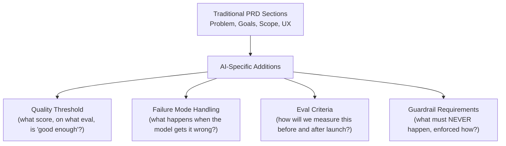

# PRDs for Probabilistic Software

> A traditional PRD says "the button does X." An AI PRD has to say "the model does X about 90% of the time — and here's what happens for the other 10%."

**Type:** Learn
**Languages:** Concept
**Prerequisites:** Problem-Model Fit
**Time:** ~30 minutes

## Learning Objectives

- Understand why traditional PRD formats (fixed acceptance criteria) don't fully fit probabilistic AI features
- Recognize the additional sections an AI PRD needs: quality thresholds, failure mode handling, and eval criteria
- Understand how to write acceptance criteria for a feature that won't behave identically every time
- Formulate the right questions when reviewing an AI feature's PRD for completeness

## The Problem

A PRD for an AI summarization feature says "the feature should summarize documents accurately." This is unfalsifiable and untestable as written — there's no defined threshold for "accurate enough," no specification of what should happen when the model gets it wrong, and no eval criteria (Level 8) an engineer could use to know whether they've actually met the requirement. A traditional PRD writer, unfamiliar with AI's non-deterministic nature (Level 2), might not realize this gap exists.

## The Concept

A PRD (Product Requirements Document) for an AI feature needs everything a traditional PRD has (user problem, goals, scope) plus several AI-specific sections that account for probabilistic, imperfect behavior.



### Quality Thresholds Instead of Binary Acceptance Criteria

Instead of "the feature works correctly," an AI PRD needs a specific, measurable quality bar: "the feature achieves at least 85% faithfulness and 80% answer relevance (Level 5's RAG evaluation metrics) on our golden dataset (Level 8) before launch." This gives engineering a concrete, testable target instead of an ambiguous aspiration.

### Explicit Failure Mode Handling

Since the feature will sometimes be wrong, the PRD must specify what happens when it is: does the user see a low-confidence warning, is there a fallback to a simpler deterministic behavior, is there an easy path to escalate to a human? Leaving this unspecified means engineering decides it ad hoc, often inconsistently across similar features.

### Eval Criteria Defined Alongside the Feature, Not After

The PRD should specify how quality will actually be measured — which golden dataset, which scoring method (Level 8) — decided at the same time as the feature requirements, not bolted on afterward once someone asks "how do we know if this works."

### Guardrail Requirements as Explicit, Testable Rules

Anything that must never happen (disclosing certain data, discussing certain topics) belongs in the PRD as an explicit guardrail requirement (Level 8), distinct from a "nice to have" behavioral preference — making clear it needs enforced, deterministic protection, not just a prompt instruction.

## Build It

A simplified comparison of a traditional-style PRD excerpt versus an AI-adapted PRD excerpt for the same feature:

```python
traditional_prd_excerpt = {
    "feature": "AI document summarizer",
    "acceptance_criteria": "The feature should summarize documents accurately and be helpful to users.",
}

ai_adapted_prd_excerpt = {
    "feature": "AI document summarizer",
    "quality_threshold": "Faithfulness >= 0.85 and answer relevance >= 0.80 on the golden dataset before launch.",
    "failure_mode_handling": (
        "If confidence is low (below internal threshold), show a 'Review recommended' badge "
        "on the summary rather than presenting it as fully verified."
    ),
    "eval_criteria": (
        "Evaluated against the 'document-summarization-v2' golden dataset (50 representative documents), "
        "using LLM-as-judge scoring for faithfulness and answer relevance."
    ),
    "guardrail_requirements": (
        "Must never include any PII (SSNs, account numbers) from the source document in the summary "
        "output, enforced via an output guardrail, not solely a prompt instruction."
    ),
}

def check_prd_completeness(prd):
    required_ai_fields = ["quality_threshold", "failure_mode_handling", "eval_criteria", "guardrail_requirements"]
    missing = [field for field in required_ai_fields if field not in prd]
    return missing

print("Traditional-style PRD missing fields for an AI feature:")
print(f"  {check_prd_completeness(traditional_prd_excerpt)}")

print("\nAI-adapted PRD missing fields:")
print(f"  {check_prd_completeness(ai_adapted_prd_excerpt)}")
```

The traditional-style PRD is missing every AI-specific field an engineer would need to actually know when the feature is done and how to handle its inevitable imperfect cases — while the AI-adapted version gives concrete, testable, engineerable requirements.

## Use It

Mature AI product teams standardize this PRD structure across their features:

- **PRD templates with built-in AI-specific sections**, so quality thresholds and failure handling aren't forgotten on any given feature.
- **Cross-functional review before finalizing quality thresholds**: involving both product and engineering in setting a realistic, meaningful bar, rather than product setting an arbitrary number in isolation.
- **PRDs referencing specific golden datasets and eval methods** (Level 8), keeping the requirements document and the actual measurement process tightly linked.

## Exercises

1. **Easy**: Identify what's missing from "the chatbot should be helpful and accurate" as an AI feature's acceptance criteria.
2. **Medium**: Write a specific, measurable quality threshold for a customer support chatbot's "answer relevance" requirement, including what golden dataset or eval approach you'd reference.
3. **Hard**: Propose failure mode handling for an AI feature that drafts legal contract clauses for a lawyer to review — what should happen when the model's confidence is low, and what should never happen regardless of confidence?

## TPM Perspective

### Strategic Executive Summary
A PRD that doesn't account for an AI feature's probabilistic nature sets engineering up to guess at what "done" means, and leaves failure mode handling as an unplanned, ad hoc decision made under time pressure. Requiring quality thresholds, failure mode handling, eval criteria, and guardrail requirements as standard PRD sections for any AI feature closes this gap and gives engineering a genuinely testable target.

### Questions to Challenge Engineering
1. *"Does this PRD specify a concrete quality threshold and eval method, or does it just say the feature should be 'accurate' and 'helpful' without a measurable bar?"*
2. *"What happens when this feature gets it wrong — is failure mode handling explicitly specified, or is it being decided ad hoc during implementation?"*
3. *"Are guardrail requirements (things that must never happen) explicitly listed and specified as enforced, deterministic controls, distinct from general behavioral preferences?"*

### Trade-Off Matrix

| PRD Approach | Testability | Engineering Clarity | Risk of Ad Hoc Decisions |
| :--- | :--- | :--- | :--- |
| **Traditional-style ("should be accurate/helpful")** | Very low — unfalsifiable | Low — ambiguous target | High — failure handling improvised late |
| **AI-adapted (quality thresholds, failure handling, eval criteria, guardrails)** | High — concrete, measurable | High — clear target | Low — decisions made deliberately upfront |

## Key Terms

- **Quality Threshold**: A specific, measurable quality bar (e.g. a minimum eval score) an AI feature must meet before launch, replacing vague acceptance criteria.
- **Failure Mode Handling**: Explicit specification of what a feature should do when the AI component produces a wrong or low-confidence output.
- **Eval Criteria (in a PRD)**: The specific golden dataset and scoring method that will be used to measure whether a feature meets its quality threshold.
- **Guardrail Requirement**: A PRD-level specification of something that must never happen, requiring deterministic enforcement rather than a behavioral preference.
