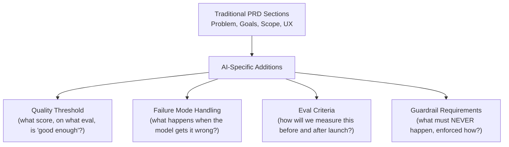

# PRDs for Probabilistic Software

> A traditional PRD says "the button does X." An AI PRD has to say "the model does X about 90% of the time — and here's what happens for the other 10%."

**Type:** Learn
**Prerequisites:** Problem-Model Fit
**Time:** ~20 minutes

## Learning Objectives

- Explain why traditional PRD formats (fixed acceptance criteria) don't fully fit probabilistic AI features
- Recognize the additional sections an AI PRD needs: quality thresholds, failure mode handling, and eval criteria
- Describe how to write acceptance criteria for a feature that won't behave identically every time
- Formulate the right questions when reviewing an AI feature's PRD for completeness

## What It Is

A PRD (Product Requirements Document) for an AI feature needs everything a traditional PRD has (user problem, goals, scope, UX) plus AI-specific sections that account for probabilistic, imperfect behavior:

- **Quality threshold**: a specific, measurable bar instead of "works correctly," for example "at least 85% faithfulness and 80% answer relevance (Level 5's RAG metrics) on our golden dataset (Level 8) before launch."
- **Failure mode handling**: since the feature will sometimes be wrong, what happens then? A low-confidence warning, a fallback to deterministic behavior, an easy path to a human. Left unspecified, engineering decides ad hoc and inconsistently.
- **Eval criteria**: which golden dataset and scoring method (Level 8) will measure quality, decided with the feature requirements rather than bolted on later.
- **Guardrail requirements**: anything that must never happen (disclosing certain data, discussing certain topics) is an explicit, testable rule enforced deterministically, distinct from a behavioral preference.

## Why It Matters

A PRD for an AI summarization feature says "the feature should summarize documents accurately." This is unfalsifiable and untestable. There is no threshold for "accurate enough," no specification of what happens when the model is wrong, and no eval criteria (Level 8) an engineer could use to know the requirement is met. A traditional PRD writer unfamiliar with AI's non-determinism (Level 2) may not see the gap.

## How It Works

1. Start from the traditional PRD: problem, goals, scope, UX.
2. Add the quality threshold, agreed jointly by product and engineering so the bar is realistic and meaningful rather than an arbitrary number.
3. Specify failure handling for low-confidence and wrong outputs.
4. Name the golden dataset and scoring method.
5. List the guardrail requirements and how they will be enforced.
6. Review the whole PRD against a template so no AI section is forgotten.

## Architecture and Workflow



```archify
src: diagrams/prd-ai-additions.html
title: How an AI PRD extends the traditional PRD
aspect: 990/468
```

## A Real-World Example

The same document summarizer feature, specified two ways:

| PRD section | Traditional style | AI-adapted style |
| :--- | :--- | :--- |
| Acceptance criteria | "Summarize documents accurately and be helpful to users." | Faithfulness at least 0.85 and answer relevance at least 0.80 on the golden dataset before launch |
| Failure mode handling | Missing | Low-confidence summaries show a "Review recommended" badge instead of appearing fully verified |
| Eval criteria | Missing | A named golden dataset of 50 representative documents, scored by LLM-as-judge for faithfulness and relevance |
| Guardrail requirements | Missing | Never include PII (SSNs, account numbers) from the source in the summary, enforced by an output guardrail, not only a prompt instruction |

The traditional version lacks every field an engineer needs to know when the feature is done and how to handle its inevitable imperfect cases. The AI-adapted version is concrete, testable, and buildable. Mature teams standardize this in PRD templates, hold cross-functional reviews of thresholds, and link PRDs to specific datasets and eval methods.

## What a TPM Needs to Understand

- A PRD that ignores probabilistic behavior leaves engineering guessing at "done" and leaves failure handling as an unplanned decision made under time pressure.
- Quality thresholds, failure handling, eval criteria, and guardrail requirements should be mandatory sections for any AI feature.
- Thresholds are negotiated trade-offs, not facts: a higher bar costs time, data, and possibly a more expensive model.
- The PRD, the golden dataset, and the launch gate (Level 8 CI/CD) should line up: the number in the PRD is the number the pipeline enforces.

## Risks, Dependencies, and Trade-Offs

| PRD Approach | Testability | Engineering Clarity | Risk of Ad Hoc Decisions |
| :--- | :--- | :--- | :--- |
| **Traditional-style ("should be accurate/helpful")** | Very low: unfalsifiable | Low: ambiguous target | High: failure handling improvised late |
| **AI-adapted (quality thresholds, failure handling, eval criteria, guardrails)** | High: concrete, measurable | High: clear target | Low: decisions made deliberately upfront |

Failure scenarios: a threshold is set by product alone and turns out unreachable, delaying launch; the golden dataset named in the PRD does not exist yet; a guardrail requirement is written but only enforced via the prompt; failure handling is specified for wrong answers but not for timeouts. Dependencies: an eval capability, a golden dataset owner, UX design for low-confidence states, and engineering input on what is feasible.

## Questions to Ask Engineers

1. *"Does this PRD specify a concrete quality threshold and eval method, or does it just say the feature should be 'accurate' and 'helpful' without a measurable bar?"*
2. *"What happens when this feature gets it wrong — is failure mode handling explicitly specified, or is it being decided ad hoc during implementation?"*
3. *"Are guardrail requirements (things that must never happen) explicitly listed and specified as enforced, deterministic controls, distinct from general behavioral preferences?"*

## Scenario Exercise

Product hands you a draft PRD for a support chatbot that says: "The chatbot should be helpful and accurate."

1. **Easy**: Identify what is missing from that acceptance criterion.
2. **Medium**: Write a specific, measurable quality threshold for the chatbot's "answer relevance" requirement, including which golden dataset or eval approach you would reference.
3. **Hard**: For an AI feature that drafts legal contract clauses for a lawyer to review, propose failure mode handling when confidence is low, and name what should never happen regardless of confidence.

## Key Terms

- **Quality Threshold**: A specific, measurable quality bar (e.g. a minimum eval score) an AI feature must meet before launch, replacing vague acceptance criteria.
- **Failure Mode Handling**: Explicit specification of what a feature should do when the AI component produces a wrong or low-confidence output.
- **Eval Criteria (in a PRD)**: The specific golden dataset and scoring method that will be used to measure whether a feature meets its quality threshold.
- **Guardrail Requirement**: A PRD-level specification of something that must never happen, requiring deterministic enforcement rather than a behavioral preference.
