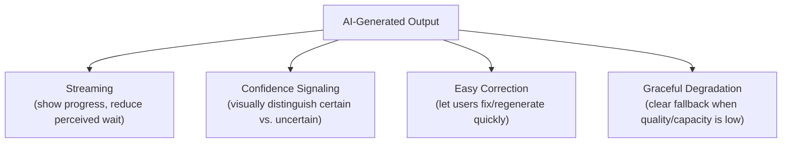

# AI UX Patterns

> Good AI UX doesn't hide the model's uncertainty from the user — it designs around it.

**Type:** Learn
**Prerequisites:** PRDs for Probabilistic Software
**Time:** ~20 minutes

## Learning Objectives

- Explain why UX for probabilistic AI features needs different patterns than traditional deterministic UI
- Recognize common AI UX patterns: streaming, confidence signaling, easy correction, and graceful degradation
- Explain why hiding AI uncertainty from users usually backfires
- Formulate the right questions when reviewing an AI feature's UX design for how it handles imperfect output

## What It Is

AI-specific UX patterns exist to handle a fact traditional deterministic UI does not design for: the output is sometimes wrong, and the interface should account for that honestly rather than presenting every response identically.

- **Streaming output**: showing generated tokens as they arrive rather than waiting for the full response (the "perceived speed" idea from the latency lesson). Users start reading before generation finishes.
- **Confidence signaling**: visually distinguishing high-confidence or grounded output from lower-confidence or unverified output, for example a citation link on a RAG-grounded claim (Level 5), a "double-check this" indicator, or simply not giving every response the same unearned authority.
- **Easy correction and regeneration**: because the same prompt can give a different, possibly better result (Level 2), give users a quick way to regenerate or refine instead of re-typing the request.
- **Graceful degradation**: when the feature is rate-limited (Level 4), a guardrail blocks a response (Level 8), or quality is degraded, say so clearly ("high demand, response may be delayed" or "this request couldn't be completed") instead of showing a broken or truncated experience.

## Why It Matters

An AI feature presents every response with the same confident, polished styling as a verified fact. There is no visual difference between "the model is very confident" and "the model is essentially guessing." Users take a wrong answer at face value because the UI gave no reason to be skeptical, and trust collapses when the mistake is discovered. This is a UX failure, not a model failure: the interface concealed uncertainty that was always there.

## How It Works

The interface chooses a presentation based on the state of each response:

1. If the request was rate-limited, show a clear, friendly degraded-service notice and no answer.
2. If the guardrail blocked the response, explain that the request could not be completed.
3. If confidence is low, show the answer with a warning badge such as "This answer may need double-checking."
4. If the answer is grounded in sources, show it with citations or a "Sourced from your documents" badge.
5. Otherwise show a standard response, always with regenerate and refine controls and streaming while it generates.

The key design principle is that each state gets its own deliberate treatment rather than being flattened into one generic "here is the AI's answer."

## Architecture and Workflow



```archify
src: diagrams/ai-output-ux-patterns.html
title: Four UX patterns for AI-generated output
aspect: 680/468
```

## A Real-World Example

Three common situations in the same assistant, each with its own treatment:

| Situation | Signal available | UI treatment |
| :--- | :--- | :--- |
| "Our return policy allows 30 days." | Confidence 0.92, source citations present | Normal styling with a "Sourced from your documents" badge and links |
| "I believe the answer is around 40%, but I'm not fully certain." | Confidence 0.35, no citations | Answer shown with a "This answer may need double-checking" warning style |
| Request rejected due to rate limiting | No answer produced | A calm notice: "We're experiencing high demand right now. Please try again shortly." |

The rate-limited user gets an honest explanation rather than a generic broken-looking error, which keeps trust intact. Real products apply this widely: chat interfaces stream token by token for perceived speed, RAG assistants show citations (Level 5's faithfulness made visible), and regenerate/refine buttons are standard because the first response is not always the best.

## What a TPM Needs to Understand

- Uniform, unqualified confidence sets users up to trust wrong answers exactly as much as right ones, and the trust erosion arrives all at once when a mistake surfaces.
- UX around AI uncertainty is a product management responsibility, not a cosmetic detail left to design.
- Confidence signaling needs a real signal behind it. If the system cannot measure confidence or grounding, a badge is decoration, so ask where the signal comes from.
- UX patterns have engineering dependencies: streaming needs backend and front-end support, citations need retrieval metadata, and degradation states need the system to detect and report those conditions.

## Risks, Dependencies, and Trade-Offs

| UX Approach | User Trust Calibration | Perceived Speed | Implementation Effort |
| :--- | :--- | :--- | :--- |
| **Uniform presentation, no confidence signaling** | Poor: users over-trust wrong answers equally | N/A | Lowest |
| **Confidence signaling + citations** | Good: users can calibrate trust appropriately | N/A | Moderate |
| **Streaming + confidence signaling + graceful degradation** | Best | Improved (streaming) | Higher, but standard practice in mature products |

Failure scenarios: a confidence badge is miscalibrated and marks wrong answers as "high confidence", making things worse; too many warnings train users to ignore them; streaming exposes partial text that a guardrail later retracts; a citation points to a document that does not actually support the claim. Dependencies: reliable confidence or grounding signals, guardrail integration, and design capacity for multiple response states.

## Questions to Ask Engineers

1. *"Does our UI visually distinguish higher-confidence, grounded output from lower-confidence or unverified output, or does everything look equally authoritative?"*
2. *"When this feature is rate-limited, blocked by a guardrail, or otherwise degraded, does the user see a clear explanation, or does the interface just look broken?"*
3. *"How easy is it for a user to regenerate or refine a response they're not satisfied with, without re-typing their entire original request?"*

## Scenario Exercise

Your team is launching a document Q&A assistant to 20,000 employees. The first design shows every answer in identical styling with no sources.

1. **Easy**: What UI treatment should a rate-limited request get, and why is it better than a generic error?
2. **Medium**: Explain in plain English why showing citations for a RAG-grounded answer is a form of confidence signaling, not just a nice-to-have.
3. **Hard**: Propose a UX treatment for a coding assistant's AI-generated suggestions, considering how confidence signaling and easy correction differ from a chat Q&A feature, and name one engineering dependency each treatment creates.

## Key Terms

- **Confidence Signaling**: Visually distinguishing higher-confidence or grounded AI output from lower-confidence or unverified output.
- **Streaming Output**: Displaying generated tokens as they arrive rather than waiting for the full response, improving perceived speed.
- **Graceful Degradation (UX)**: Clearly communicating to users when a feature's quality or availability is reduced, rather than presenting a silently broken experience.
- **Easy Correction**: UI affordances letting users quickly regenerate or refine an unsatisfactory AI response without repeating their entire request.
