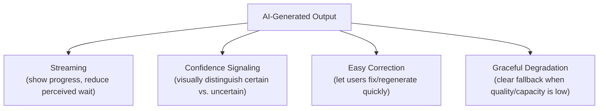

# AI UX Patterns

> Good AI UX doesn't hide the model's uncertainty from the user — it designs around it.

**Type:** Learn
**Languages:** Concept
**Prerequisites:** PRDs for Probabilistic Software
**Time:** ~25 minutes

## Learning Objectives

- Understand why UX for probabilistic AI features needs different patterns than traditional deterministic UI
- Recognize common AI UX patterns: streaming, confidence signaling, easy correction, and graceful degradation
- Understand why hiding AI uncertainty from users usually backfires
- Formulate the right questions when reviewing an AI feature's UX design for how it handles imperfect output

## The Problem

An AI feature presents every generated response with the same confident, polished styling as a verified fact — no visual distinction between "the model is very confident and this is likely correct" and "the model is essentially guessing." Users take a wrong answer at face value because the UI gave them no signal to be more skeptical, eroding trust once the mistake is discovered — a UX failure, not a model failure, since the interface actively concealed the uncertainty that was always there.

## The Concept

AI-specific UX patterns exist specifically to handle a fact traditional deterministic UI doesn't need to design for: the output is sometimes wrong, and the interface should account for that honestly rather than presenting every response identically.



### Streaming Output

Showing generated tokens as they arrive (connecting to the latency optimization lesson's "perceived speed" discussion) rather than waiting for the complete response — improves perceived responsiveness and lets users start reading/reacting before generation fully finishes.

### Confidence Signaling

Visually distinguishing high-confidence output from lower-confidence or unverified output — e.g. a citation/source link for a RAG-grounded claim (Level 5), a "double-check this" indicator for a lower-confidence answer, or simply not presenting every AI response with the same unearned visual authority as a verified fact.

### Easy Correction and Regeneration

Since the same prompt can produce a different, possibly better result (Level 2's probability lesson), giving users a quick way to regenerate or refine a response — rather than forcing them to re-type an entire request — respects that variance as a normal, expected part of interacting with the system rather than treating any single output as final.

### Graceful Degradation in the UI

When a feature is rate-limited (Level 4), a guardrail blocks a response (Level 8), or quality is otherwise degraded, the UI should communicate this clearly ("high demand, response may be delayed" or "this request couldn't be completed") rather than presenting a broken or truncated experience with no explanation.

## Build It

A simplified UI state model illustrating confidence signaling and graceful degradation as distinct states, not an afterthought:

```python
def render_response_ui(response_text, confidence_score, was_rate_limited, has_citations):
    if was_rate_limited:
        return {
            "display": "We're experiencing high demand right now. Please try again shortly.",
            "style": "degraded_notice",
        }

    if confidence_score < 0.5:
        return {
            "display": response_text,
            "style": "low_confidence_warning",
            "badge": "This answer may need double-checking",
        }

    if has_citations:
        return {
            "display": response_text,
            "style": "grounded_response",
            "badge": "Sourced from your documents",
        }

    return {
        "display": response_text,
        "style": "standard_response",
    }

scenarios = [
    ("Our return policy allows 30 days.", 0.92, False, True),
    ("I believe the answer is around 40%, but I'm not fully certain.", 0.35, False, False),
    ("", 0, True, False),
]

for text, confidence, rate_limited, citations in scenarios:
    result = render_response_ui(text, confidence, rate_limited, citations)
    print(f"Style: {result['style']}")
    print(f"  Display: {result.get('display')}")
    if "badge" in result:
        print(f"  Badge: {result['badge']}")
    print()
```

Each of these three real, common situations gets a distinct, honest UI treatment rather than being flattened into one generic "here's the AI's answer" presentation — exactly the difference between designing around uncertainty and hiding it.

## Use It

Real AI products apply these patterns as standard UX practice:

- **Chat interfaces**: nearly universally stream responses token-by-token now, specifically for the perceived-speed benefit.
- **RAG-based assistants**: commonly show citations/sources alongside generated answers, letting users verify claims rather than trusting them blindly (Level 5's faithfulness concept, made visible in the UI).
- **Regenerate/refine buttons**: a standard UI element in most modern AI chat products, acknowledging that the first response isn't always the best one.

## Exercises

1. **Easy**: In the code above, what UI treatment does a rate-limited request get, and why is that better than showing a generic broken-looking error?
2. **Medium**: Explain in plain English why showing citations for a RAG-grounded answer is a form of confidence signaling, not just a nice-to-have feature.
3. **Hard**: Propose a UX treatment for a coding assistant's AI-generated code suggestion, considering how confidence signaling and easy correction might apply differently than in a chat-based Q&A feature.

## TPM Perspective

### Strategic Executive Summary
Presenting every AI response with uniform, unqualified confidence is a common, quietly damaging UX mistake — it sets users up to trust wrong answers exactly as much as right ones, and the resulting trust erosion happens all at once when a mistake surfaces, rather than being managed gradually and honestly throughout. Designing UX patterns around AI's actual uncertainty (streaming, confidence signaling, easy correction, graceful degradation) is a core AI product management responsibility, not a cosmetic detail left entirely to design.

### Questions to Challenge Engineering
1. *"Does our UI visually distinguish higher-confidence, grounded output from lower-confidence or unverified output, or does everything look equally authoritative?"*
2. *"When this feature is rate-limited, blocked by a guardrail, or otherwise degraded, does the user see a clear explanation, or does the interface just look broken?"*
3. *"How easy is it for a user to regenerate or refine a response they're not satisfied with, without re-typing their entire original request?"*

### Trade-Off Matrix

| UX Approach | User Trust Calibration | Perceived Speed | Implementation Effort |
| :--- | :--- | :--- | :--- |
| **Uniform presentation, no confidence signaling** | Poor — users over-trust wrong answers equally | N/A | Lowest |
| **Confidence signaling + citations** | Good — users can calibrate trust appropriately | N/A | Moderate |
| **Streaming + confidence signaling + graceful degradation** | Best | Improved (streaming) | Higher, but standard practice in mature products |

## Key Terms

- **Confidence Signaling**: Visually distinguishing higher-confidence or grounded AI output from lower-confidence or unverified output.
- **Streaming Output**: Displaying generated tokens as they arrive rather than waiting for the full response, improving perceived speed.
- **Graceful Degradation (UX)**: Clearly communicating to users when a feature's quality or availability is reduced, rather than presenting a silently broken experience.
- **Easy Correction**: UI affordances letting users quickly regenerate or refine an unsatisfactory AI response without repeating their entire request.
