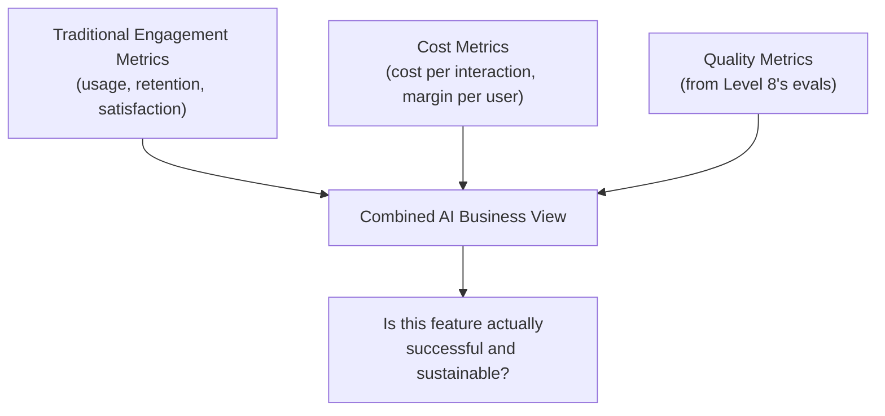

# Business Metrics for AI Products

> "Users love it" and "it's profitable" are two different questions — an AI feature needs to answer both, separately.

**Type:** Learn
**Prerequisites:** AI UX Patterns
**Time:** ~20 minutes

## Learning Objectives

- Explain why AI features need cost-aware business metrics beyond typical product engagement metrics
- Describe key metrics: cost per interaction, margin per user, quality-adjusted engagement, and deflection/containment rate
- Recognize why engagement alone can hide an unprofitable or low-quality feature
- Formulate the right questions when reviewing an AI feature's reported business impact

## What It Is

AI product business metrics combine traditional product metrics with AI-specific cost and quality dimensions, since neither alone tells the full story.

- **Cost per interaction and margin per user**: building on token economics (Level 4), every AI interaction has a real, calculable cost. Viability depends on that cost relative to the value or revenue generated. "Growing usage" without this context can mean growing losses.
- **Quality-adjusted engagement**: raw engagement (messages, sessions) cannot distinguish "users get value quickly" from "users keep re-asking because answers are unsatisfying." Pair it with quality signals from Level 8's evals (faithfulness, relevance, thumbs-up rate).
- **Deflection (containment) rate**: for features meant to reduce human workload, such as a support chatbot, the percentage of interactions fully resolved by the AI without a human. It is often the single most important business metric, tied directly to cost savings.

## Why It Matters

A team reports its new AI chatbot has "50,000 daily interactions and rising" as proof of success. What is missing: cost per interaction (Level 4) may make the feature deeply unprofitable at scale, and rising interactions could just as easily mean users keep re-asking because the first answer was wrong. Engagement alone cannot tell these stories apart.

## How It Works

1. Measure daily interactions (usage).
2. Multiply by cost per interaction to get daily cost.
3. Multiply by value or savings per interaction to get daily value.
4. Subtract to get daily margin, and flag unprofitable features.
5. Check average quality against a health threshold (for example, 0.75).
6. For workload-reduction features, check deflection against a target (for example, 60%).
7. Read all of them together: a decision needs cost, quality, and deflection, not engagement alone.

## Architecture and Workflow



```archify
src: diagrams/combined-ai-business-view.html
title: Three metric families combine into one business view
aspect: 1060/368
```

## A Real-World Example

The chatbot reported as a success on engagement alone, viewed in full:

| Metric | Value | Reading |
| :--- | :--- | :--- |
| Daily interactions | 50,000 | Looks great on its own |
| Cost per interaction | $0.08 | Daily cost $4,000 |
| Value or savings per interaction | $0.03 | Daily value $1,500 |
| Daily margin | -$2,500 | Unprofitable, losing $0.05 on every interaction (about $75,000 per month) |
| Average quality score | 0.58 | Below the 0.75 health threshold |
| Deflection rate | 35% | Below the 60% target, so most chats still reach a human |

The "growing usage" story looks very different once cost, quality, and deflection are included. Mature organizations report all of these together in quarterly reviews, track deflection as the primary metric for support AI, and put usage and quality trends side by side to see whether rising usage correlates with rising or falling quality.

## What a TPM Needs to Understand

- Engagement alone is insufficient and potentially misleading. Insist on cost per interaction, quality-adjusted engagement, and deflection where applicable.
- Together these reveal whether growing usage reflects growing value or a growing, expensive problem.
- Unit economics can change with scale and model choice: a cheaper model may cut cost but lower quality and deflection, so metrics must be read as a set.
- Agree on definitions up front (what counts as a "resolved" chat, how value per interaction is estimated), or numbers will be disputed later.

## Risks, Dependencies, and Trade-Offs

| Metric Combination | Reveals Cost Sustainability | Reveals Quality Issues | Reveals True Value Delivered |
| :--- | :--- | :--- | :--- |
| **Engagement only** | No | No | Ambiguous: could mean value or frustration |
| **Engagement + cost per interaction** | Yes | No | Partial |
| **Engagement + cost + quality + deflection rate** | Yes | Yes | Yes: full, honest picture |

Failure scenarios: deflection is inflated because users give up rather than being helped; value per interaction is an optimistic guess that makes the margin look positive; cost per interaction rises as prompts and context grow; a cost-cutting model swap lowers quality unnoticed. Dependencies: token and cost tracking (LLMOps), quality evals (Level 8), support tooling that records escalations, and finance input on value estimates.

## Questions to Ask Engineers

1. *"What is the actual cost per interaction for this feature, and is it profitable or subsidized relative to the value or savings it generates?"*
2. *"Is rising engagement correlated with rising or falling quality scores — could this growth reflect users re-asking due to unsatisfying answers rather than genuine value?"*
3. *"For a feature meant to reduce human workload, what is our deflection/containment rate, and is it improving or declining over time?"*

## Scenario Exercise

In a quarterly review, the chatbot team presents a single chart of rising daily interactions and asks for a larger budget.

1. **Easy**: Using the table above, is the feature profitable or unprofitable per interaction, and by how much?
2. **Medium**: Explain in plain English why "50,000 daily interactions and rising" alone does not tell you whether the feature is succeeding.
3. **Hard**: Propose a combination of at least three metrics you would require in the quarterly review for a customer support chatbot, justify why each is necessary, and say what result would make you approve or reject the budget increase.

## Key Terms

- **Cost Per Interaction**: The average real cost (compute, API fees) of a single AI feature interaction, essential for assessing business viability.
- **Margin Per User**: The net value (revenue or cost savings minus cost) generated per user for an AI feature.
- **Quality-Adjusted Engagement**: Usage metrics interpreted alongside quality scores, distinguishing genuine value from repeated, frustrated re-attempts.
- **Deflection Rate (Containment Rate)**: The percentage of interactions an AI feature fully resolves without human intervention, a key metric for support/service-oriented AI features.
