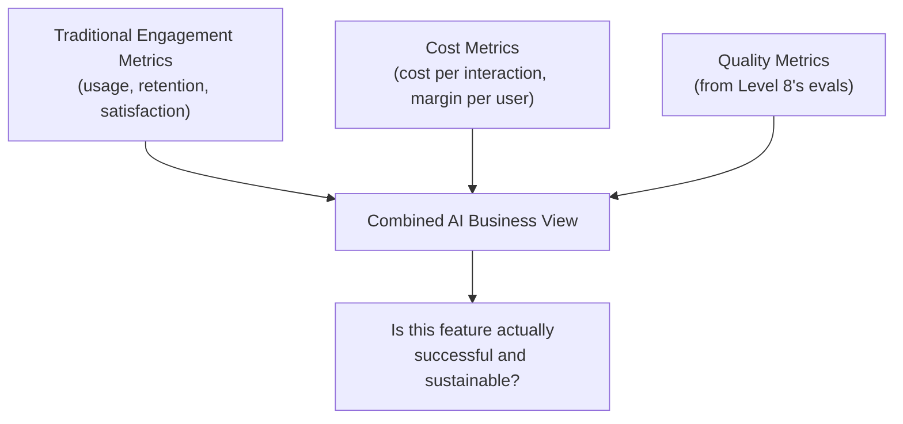

# Business Metrics for AI Products

> "Users love it" and "it's profitable" are two different questions — an AI feature needs to answer both, separately.

**Type:** Learn
**Languages:** Concept
**Prerequisites:** AI UX Patterns
**Time:** ~25 minutes

## Learning Objectives

- Understand why AI features need cost-aware business metrics beyond typical product engagement metrics
- Understand key metrics: cost per interaction, margin per user, quality-adjusted engagement, and deflection/containment rate
- Recognize why engagement alone can hide an unprofitable or low-quality feature
- Formulate the right questions when reviewing an AI feature's reported business impact

## The Problem

A team reports their new AI chatbot feature has "50,000 daily interactions and rising" as evidence of success. What's missing: the cost per interaction (Level 4's token economics) might make this feature deeply unprofitable at scale, and a rising interaction count could just as easily mean "users keep having to re-ask because the first answer was wrong" as it could mean genuine value delivered — engagement alone doesn't distinguish between these very different stories.

## The Concept

AI product business metrics need to combine traditional product metrics with AI-specific cost and quality dimensions, since neither alone tells the full story.



### Cost Per Interaction and Margin Per User

Directly building on token economics (Level 4): every AI interaction has a real, calculable cost. A feature's business viability requires knowing this cost relative to the value or revenue it generates — "growing usage" without this context can mean "growing losses," not growing success.

### Quality-Adjusted Engagement

Raw engagement (messages sent, sessions started) doesn't distinguish "users are getting value quickly" from "users keep re-asking because answers are unsatisfying." Combining engagement metrics with quality signals (from Level 8's evals — faithfulness, answer relevance, user feedback/thumbs-up rate) gives a much more honest picture of whether engagement reflects genuine value.

### Deflection / Containment Rate

For AI features designed to reduce human workload (e.g. a support chatbot meant to resolve issues without escalating to a human agent), the **deflection rate** (or containment rate) — the percentage of interactions fully resolved by the AI without human intervention — is often the single most important business metric, directly tied to cost savings and the feature's core value proposition.

### Why Engagement Alone Can Mislead

A high engagement number is genuinely ambiguous without additional context: it could reflect strong value delivery, or it could reflect a broken experience generating repeated, frustrated re-attempts. Business metrics for AI products need enough dimensions (cost, quality, deflection) to distinguish between these very different underlying realities.

## Build It

A simplified business metrics dashboard combining engagement, cost, and quality into an honest overall assessment:

```python
def evaluate_ai_feature_business_health(
    daily_interactions,
    cost_per_interaction,
    revenue_or_savings_per_interaction,
    average_quality_score,
    deflection_rate=None,
):
    daily_cost = daily_interactions * cost_per_interaction
    daily_value = daily_interactions * revenue_or_savings_per_interaction
    daily_margin = daily_value - daily_cost

    print(f"Daily interactions: {daily_interactions:,}")
    print(f"Daily cost: ${daily_cost:,.2f}")
    print(f"Daily value generated: ${daily_value:,.2f}")
    print(f"Daily margin: ${daily_margin:,.2f} ({'profitable' if daily_margin > 0 else 'UNPROFITABLE'})")
    print(f"Average quality score: {average_quality_score:.2f} "
          f"({'healthy' if average_quality_score >= 0.75 else 'CONCERNING'})")

    if deflection_rate is not None:
        print(f"Deflection rate: {deflection_rate:.0%} "
              f"({'strong' if deflection_rate >= 0.6 else 'needs improvement'})")

    print()

print("Scenario: 'Success' as reported (engagement only)")
print("  50,000 daily interactions and rising -- looks great on its own.\n")

print("Full business health picture:")
evaluate_ai_feature_business_health(
    daily_interactions=50_000,
    cost_per_interaction=0.08,
    revenue_or_savings_per_interaction=0.03,
    average_quality_score=0.58,
    deflection_rate=0.35,
)
```

The full picture reveals what the engagement-only report hid: this feature is losing money on every interaction, quality is below a healthy threshold, and deflection rate is weak — the "growing usage" story looks very different once cost, quality, and deflection are included.

## Use It

Mature AI product organizations report on all these dimensions together, not engagement alone:

- **Quarterly business reviews for AI features** typically report cost per interaction and margin alongside usage growth, not usage growth in isolation.
- **Support/service AI features** track deflection rate as a primary success metric, since it directly ties to the feature's core cost-saving value proposition.
- **Quality-adjusted engagement dashboards**: combining usage trends with quality scores (Level 8) side-by-side, so a reviewer can immediately see whether rising usage correlates with rising or falling quality.

## Exercises

1. **Easy**: In the code example, is the AI feature profitable or unprofitable per interaction, and by how much?
2. **Medium**: Explain in plain English why "50,000 daily interactions and rising" alone doesn't tell you whether an AI feature is succeeding.
3. **Hard**: Propose a specific combination of metrics (at least three) you'd require in a quarterly business review for a customer support AI chatbot, and justify why each is necessary.

## TPM Perspective

### Strategic Executive Summary
Engagement metrics alone are insufficient — and potentially misleading — for evaluating an AI feature's actual business success. A TPM should insist on cost per interaction, quality-adjusted engagement, and (where applicable) deflection rate as standard reporting alongside usage, since together they reveal whether growing usage reflects growing value or a growing, expensive problem.

### Questions to Challenge Engineering
1. *"What is the actual cost per interaction for this feature, and is it profitable or subsidized relative to the value or savings it generates?"*
2. *"Is rising engagement correlated with rising or falling quality scores — could this growth reflect users re-asking due to unsatisfying answers rather than genuine value?"*
3. *"For a feature meant to reduce human workload, what is our deflection/containment rate, and is it improving or declining over time?"*

### Trade-Off Matrix

| Metric Combination | Reveals Cost Sustainability | Reveals Quality Issues | Reveals True Value Delivered |
| :--- | :--- | :--- | :--- |
| **Engagement only** | No | No | Ambiguous — could mean value or frustration |
| **Engagement + cost per interaction** | Yes | No | Partial |
| **Engagement + cost + quality + deflection rate** | Yes | Yes | Yes — full, honest picture |

## Key Terms

- **Cost Per Interaction**: The average real cost (compute, API fees) of a single AI feature interaction, essential for assessing business viability.
- **Margin Per User**: The net value (revenue or cost savings minus cost) generated per user for an AI feature.
- **Quality-Adjusted Engagement**: Usage metrics interpreted alongside quality scores, distinguishing genuine value from repeated, frustrated re-attempts.
- **Deflection Rate (Containment Rate)**: The percentage of interactions an AI feature fully resolves without human intervention, a key metric for support/service-oriented AI features.
