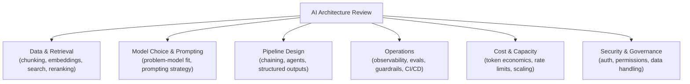

# Leading Architecture Reviews for AI Systems

> The value of an architecture review isn't catching bugs — it's catching the expensive decisions before they're poured in concrete.

**Type:** Learn
**Prerequisites:** Business Metrics for AI Products
**Time:** ~25 minutes

## Learning Objectives

- Explain the specific purpose of an architecture review for an AI system, distinct from a code review
- Recognize the standard checklist of AI-specific architecture concerns spanning every earlier level in this curriculum
- Describe how to facilitate a review that surfaces real risks without becoming either a rubber stamp or an obstacle
- Define a repeatable structure for reviewing any proposed AI system design

## What It Is

An AI architecture review is a structured examination of a proposed system's design, held before or early in implementation, aimed at catching high-cost mistakes while they are still cheap to change. It is not a code review: nobody is reading code. The question is whether the major decisions (data, model, pipeline, operations, cost, security) have been made deliberately.

The review works best as a checklist against six dimensions, because a real AI system touches all of them. A checklist makes the review repeatable and thorough, where a free-form discussion drifts toward whatever topic is most interesting to the people in the room.

## Why It Matters

A team presents an architecture for a new RAG-based support agent. The review spends 45 minutes on which vector database vendor to use, while nobody asks about chunking strategy, evaluation approach, cost projections, or guardrails. The review technically happened, but it never examined the decisions most likely to determine whether the system works well or costs a reasonable amount. A review focused on the wrong questions is barely better than no review at all.

## How It Works

The review walks the six dimensions in order, asking pointed questions rather than "any concerns?".

1. **Data and Retrieval** (Level 5): What is the chunking strategy? Which embedding model, and was it validated for this domain? Is reranking used? How is retrieval quality measured?
2. **Model Choice and Prompting** (Levels 2-3, 9): Is this a genuinely good problem-model fit? Why this model over cheaper or faster ones? Has prompt engineering been exhausted before fine-tuning is considered?
3. **Pipeline Design** (Levels 4, 6-7): Single call, prompt chain, or agent loop, and is the complexity justified? Which tools and MCP servers does it depend on, and are they scoped appropriately?
4. **Operations** (Level 8): Is there tracing? What is the eval strategy and golden dataset? Are guardrails enforced deterministically or only prompted?
5. **Cost and Capacity** (Levels 0, 4): What is the projected cost per interaction at expected scale? What rate limit assumptions exist, and is there a capacity plan behind them?
6. **Security and Governance** (Level 7): How are authentication and per-user authorization handled? What data does the system touch, and what is the audit trail?

The facilitator treats "we haven't decided that yet" as a valid, useful answer. It surfaces a gap; it is not a failure to be embarrassed about. Each gap is then either resolved or logged with an owner and a date.

## Architecture and Workflow



```archify
src: diagrams/arch-review.html
title: Walk the checklist over a real system: the RAG support agent
aspect: 718/292
```

## A Real-World Example

Scoring the opening scenario's RAG support agent proposal against the checklist shows what the vendor-only discussion missed. Of 14 checklist items, 3 were covered and 11 were open.

| Dimension | Items covered | Open gaps |
| :--- | :--- | :--- |
| Data and Retrieval | 0 of 4 | Chunking strategy, embedding validation for the domain, reranking decision, retrieval quality measurement plan |
| Model and Prompting | 2 of 3 | Model choice not justified against cheaper options |
| Operations | 0 of 3 | Tracing, golden eval dataset, guardrails |
| Cost and Capacity | 0 of 2 | Cost per interaction not projected, no capacity plan |
| Security | 1 of 2 | No audit logging planned (per-user authorization is planned) |

The output is a concrete, prioritized follow-up list instead of a vague feeling that "something felt incomplete." Mature teams standardize this: one written template covering all six dimensions, explicit "gaps to close before launch" tracking, and a review held early enough that findings can still change the design.

## What a TPM Needs to Understand

- The review's value comes from checking the specific decisions this curriculum has shown to be high-risk if skipped: chunking, model fit, eval strategy, guardrails, cost projection, and access control.
- The TPM drives toward the checklist, makes sure every gap is resolved or explicitly tracked, and resists the review becoming a rubber stamp or an unfocused debate.
- Timing matters as much as content. A review after implementation has locked in decisions finds problems that are expensive to fix.
- You do not need to know the right answer to each item. You need to know the question, who owns it, and when it will be closed.

## Risks, Dependencies, and Trade-Offs

| Review Approach | Thoroughness | Risk of Missed Issues | Time Investment |
| :--- | :--- | :--- | :--- |
| **Open-ended discussion, no checklist** | Low, inconsistent | High, easy to drift and miss key dimensions | Variable |
| **Checklist-driven review across all six dimensions** | High, consistent | Low, systematic coverage | Moderate, but efficient |
| **No review at all** | None | Very high | None upfront, high cost later |

- **Dependency:** the right people must attend (data, ML, security, operations, finance). A review missing the person who owns a dimension silently skips it.
- **Failure scenario: rubber stamp.** Everyone nods, gaps are never logged, launch proceeds. Mitigation: require a written gap list with owners.
- **Failure scenario: obstacle.** Reviewers demand every item be perfect before any progress. Mitigation: distinguish "must close before launch" from "track and revisit".

## Questions to Ask Engineers

1. *"Walking through our six-dimension checklist, which items are fully addressed, which are open gaps, and what's the plan to close each gap before launch?"*
2. *"Is this review happening early enough that findings can still meaningfully change the design, or has implementation already locked in decisions we're only now examining?"*
3. *"For any item marked 'we haven't decided that yet,' who owns closing that gap, and by when?"*

## Scenario Exercise

A team asks for approval of a new AI agent that can issue refunds. Their design deck covers the model vendor and UI in detail and says little else.

1. **Easy**: Name two operations gaps from the support-agent example that a review would flag as unaddressed.
2. **Medium**: Explain in plain English why spending most of a review on vector database vendor choice, while skipping chunking and eval strategy, is poor facilitation.
3. **Hard**: Outline a one-page review template (section headers plus 2-3 key questions each) you would use for this refund agent before implementation begins, and say which two questions you would treat as launch blockers.

## Key Terms

- **Architecture Review**: A structured examination of a proposed system's design before or during implementation, aimed at catching high-cost mistakes early.
- **Six-Dimension Checklist**: A repeatable framework covering data/retrieval, model/prompting, pipeline design, operations, cost/capacity, and security for AI system reviews.
- **Open Gap**: An architecture review finding where a required decision hasn't yet been made, tracked explicitly rather than left unresolved silently.
