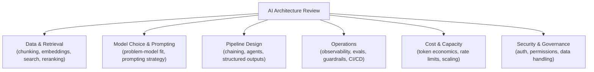

# Leading Architecture Reviews for AI Systems

> The value of an architecture review isn't catching bugs — it's catching the expensive decisions before they're poured in concrete.

**Type:** Learn
**Languages:** Concept
**Prerequisites:** Business Metrics for AI Products
**Time:** ~30 minutes

## Learning Objectives

- Understand the specific purpose of an architecture review for an AI system, distinct from a code review
- Recognize the standard checklist of AI-specific architecture concerns spanning every earlier level in this curriculum
- Understand how to facilitate a review that surfaces real risks without becoming either a rubber stamp or an obstacle
- Formulate a repeatable structure for reviewing any proposed AI system design

## The Problem

A team presents an architecture for a new RAG-based support agent, and the review meeting spends 45 minutes discussing which vector database vendor to use, while nobody asks about chunking strategy, evaluation approach, cost projections, or guardrails. The review technically happened, but it didn't examine the decisions most likely to determine whether this system actually works well or costs a reasonable amount — a review focused on the wrong questions is barely better than no review at all.

## The Concept

An AI architecture review should systematically walk through the concerns raised across this entire curriculum, because a real AI system touches all of them — treating the review as a checklist against these dimensions, rather than an open-ended discussion, is what makes it repeatable and thorough.



### The Six-Dimension Checklist

1. **Data & Retrieval** (Level 5): What's the chunking strategy? Which embedding model, and was it validated for this domain? Is reranking used? How is retrieval quality actually measured?
2. **Model Choice & Prompting** (Levels 2-3, 9): Is this genuinely a good problem-model fit? Which model, and why this one over cheaper/faster alternatives? Has prompt engineering been exhausted before considering fine-tuning?
3. **Pipeline Design** (Levels 4, 6-7): Is this a single call, a prompt chain, or an agent loop — and is that complexity justified by the task? What tools/MCP servers does it depend on, and are they scoped appropriately?
4. **Operations** (Level 8): Is there tracing/observability in place? What's the eval strategy and golden dataset? What guardrails exist, and are they enforced deterministically or just prompted?
5. **Cost & Capacity** (Levels 0, 4): What's the projected cost per interaction at expected scale? What are the rate limit assumptions, and is there a capacity plan (next lesson) behind them?
6. **Security & Governance** (Level 7): How is authentication and per-user authorization handled? What data does this system touch, and what's the audit trail?

### Facilitating a Review That Surfaces Real Risk

A good architecture review facilitator asks pointed, specific questions from this checklist rather than a generic "any concerns?" — and treats "we haven't decided that yet" as a valid, useful answer that surfaces a gap, not a failure to be embarrassed about. The goal is finding the expensive mistake before it's built, not performing due diligence for its own sake.

## Build It

A simplified architecture review checklist scoring tool, applied to the opening scenario's RAG support agent proposal:

```python
review_checklist = {
    "data_retrieval": {
        "chunking_strategy_defined": False,
        "embedding_model_validated_for_domain": False,
        "reranking_considered": False,
        "retrieval_quality_measurement_plan": False,
    },
    "model_and_prompting": {
        "problem_model_fit_assessed": True,
        "model_choice_justified": False,
        "prompt_engineering_exhausted_first": True,
    },
    "operations": {
        "tracing_planned": False,
        "eval_golden_dataset_planned": False,
        "guardrails_defined": False,
    },
    "cost_and_capacity": {
        "cost_per_interaction_projected": False,
        "capacity_plan_exists": False,
    },
    "security": {
        "per_user_authorization_planned": True,
        "audit_logging_planned": False,
    },
}

def summarize_review(checklist):
    total_items = 0
    covered_items = 0
    gaps = []

    for category, items in checklist.items():
        for item, covered in items.items():
            total_items += 1
            if covered:
                covered_items += 1
            else:
                gaps.append(f"{category}.{item}")

    print(f"Architecture review coverage: {covered_items}/{total_items} items addressed\n")
    print("Open gaps requiring follow-up before approval:")
    for gap in gaps:
        print(f"  - {gap}")

summarize_review(review_checklist)
```

Running this against the opening scenario reveals exactly what a vector-database-vendor-only discussion missed — chunking, eval strategy, cost projections, and guardrails are all still open, giving the review a concrete, prioritized follow-up list instead of a vague sense that "something felt incomplete."

## Use It

Teams with mature AI program management practices standardize this review structure:

- **A written architecture review template** covering all six dimensions, used consistently across every new AI system proposal, not reinvented each time.
- **Explicit "gaps requiring follow-up before launch" tracking**, similar to how open questions from a traditional design review are tracked to resolution.
- **Review timing early enough to matter**: conducted while the design is still flexible, not after implementation has already locked in decisions that would be expensive to revisit.

## Exercises

1. **Easy**: In the checklist example, name two "operations" gaps that were left unaddressed.
2. **Medium**: Explain in plain English why spending most of a review meeting on vector database vendor choice, while skipping chunking and eval strategy, is a poorly-facilitated review.
3. **Hard**: Design a one-page architecture review template (just the section headers and 2-3 key questions per section) for reviewing a new AI agent system before implementation begins.

## TPM Perspective

### Strategic Executive Summary
An AI architecture review's value comes from systematically checking the specific decisions this curriculum has shown to be high-risk if skipped — chunking, model fit, eval strategy, guardrails, cost projection, and access control — not from a free-form discussion that can easily drift toward whichever topic is most interesting to whoever is in the room. A TPM facilitating this review should drive toward the checklist, ensure every gap is either resolved or explicitly tracked, and resist letting the review become either a rubber stamp or an unfocused debate.

### Questions to Challenge Engineering
1. *"Walking through our six-dimension checklist, which items are fully addressed, which are open gaps, and what's the plan to close each gap before launch?"*
2. *"Is this review happening early enough that findings can still meaningfully change the design, or has implementation already locked in decisions we're only now examining?"*
3. *"For any item marked 'we haven't decided that yet,' who owns closing that gap, and by when?"*

### Trade-Off Matrix

| Review Approach | Thoroughness | Risk of Missed Issues | Time Investment |
| :--- | :--- | :--- | :--- |
| **Open-ended discussion, no checklist** | Low, inconsistent | High — easy to drift and miss key dimensions | Variable |
| **Checklist-driven review across all six dimensions** | High, consistent | Low — systematic coverage | Moderate, but efficient |
| **No review at all** | None | Very high | None upfront, high cost later |

## Key Terms

- **Architecture Review**: A structured examination of a proposed system's design before or during implementation, aimed at catching high-cost mistakes early.
- **Six-Dimension Checklist**: A repeatable framework covering data/retrieval, model/prompting, pipeline design, operations, cost/capacity, and security for AI system reviews.
- **Open Gap**: An architecture review finding where a required decision hasn't yet been made, tracked explicitly rather than left unresolved silently.
