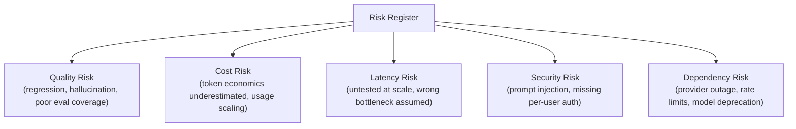

# Technical Risk Management for AI Programs

> Every AI program has a handful of risks that are entirely predictable in advance — the job is naming them before they become incidents, not explaining them after.

**Type:** Learn
**Languages:** Concept
**Prerequisites:** Leading Architecture Reviews for AI Systems
**Time:** ~30 minutes

## Learning Objectives

- Understand a structured approach to identifying AI-specific technical risks early in a program
- Recognize the recurring risk categories this curriculum has covered: quality, cost, latency, security, and dependency risk
- Understand how to score and prioritize risks so mitigation effort goes where it matters most
- Formulate a standard risk register practice for an AI program

## The Problem

A program launches an AI feature and, within the first month, hits three "surprises": costs are 5x higher than expected, a quality regression from an unreviewed prompt change went unnoticed for two weeks, and a provider's rate limit caused a visible outage during a traffic spike. None of these were actually surprising — every one of them is a well-known, common risk category covered explicitly in this curriculum (Levels 4 and 8) — they simply weren't identified and tracked as risks before launch.

## The Concept

Technical risk management for AI programs means systematically identifying, in advance, the risks that recur across nearly every AI program — not waiting to discover them as incidents.



### The Five Recurring AI Risk Categories

1. **Quality risk** (Levels 8-9): a prompt/model change regresses output quality without an eval gate catching it; hallucination causes user-facing harm; evaluation coverage misses a real failure mode.
2. **Cost risk** (Level 4): token economics were estimated informally rather than calculated; usage scales faster than projected; a change in conversation length or system prompt size silently multiplies cost.
3. **Latency risk** (Level 8): a bottleneck assumption (e.g. "the model call is slow") turns out to be wrong once measured, and the actual bottleneck (retrieval, guardrails) was never tested at realistic scale.
4. **Security risk** (Levels 6-8): prompt injection via untrusted retrieved content; missing per-user authorization on an MCP integration; an over-privileged agent tool.
5. **Dependency risk** (Levels 0, 4, 7): a model provider's rate limits, pricing, or model version changes unexpectedly; a critical MCP server or vector database dependency has its own outage.

### Scoring Risk: Likelihood x Impact

Each identified risk should be scored on two dimensions — how likely it is to occur, and how severe the impact would be if it did — with mitigation effort prioritized toward high-likelihood, high-impact risks first, rather than spreading effort evenly across every risk regardless of severity.

```
Risk Priority = Likelihood (1-5) x Impact (1-5)

Example: "Cost estimate is significantly wrong" -> Likelihood 4, Impact 4 -> Priority 16 (high)
Example: "Vector database vendor changes their logo" -> Likelihood 3, Impact 1 -> Priority 3 (low)
```

## Build It

A simplified risk register applying the five categories and likelihood x impact scoring to a hypothetical AI program:

```python
risks = [
    {"category": "cost", "description": "Token cost estimate based on rough guess, not measured", "likelihood": 4, "impact": 4},
    {"category": "quality", "description": "No eval gate in CI/CD for prompt changes", "likelihood": 4, "impact": 5},
    {"category": "latency", "description": "Retrieval latency untested at expected peak concurrency", "likelihood": 3, "impact": 3},
    {"category": "security", "description": "MCP server uses shared service account, no per-user auth", "likelihood": 3, "impact": 5},
    {"category": "dependency", "description": "No fallback plan if primary model provider has an outage", "likelihood": 2, "impact": 4},
]

def score_and_prioritize(risk_list):
    for risk in risk_list:
        risk["priority"] = risk["likelihood"] * risk["impact"]
    return sorted(risk_list, key=lambda r: r["priority"], reverse=True)

prioritized = score_and_prioritize(risks)

print("Risk register, prioritized by likelihood x impact:\n")
for risk in prioritized:
    print(f"  [{risk['priority']:2d}] ({risk['category']}) {risk['description']}")
    print(f"       likelihood={risk['likelihood']}, impact={risk['impact']}")
```

This produces a concrete, ranked list — showing that missing a CI/CD eval gate and missing per-user auth are the two highest-priority risks to mitigate first, ahead of the lower-scored latency risk, giving the team a defensible basis for where to focus limited mitigation effort.

## Use It

Mature AI programs maintain risk management as an ongoing practice, not a one-time pre-launch exercise:

- **A living risk register**, reviewed and updated regularly as the program evolves, not created once and forgotten.
- **Risk-informed prioritization of engineering work**, where addressing a high-priority risk (like adding an eval gate) competes fairly against new feature work rather than being perpetually deprioritized.
- **Post-incident risk register updates**: when an unanticipated issue does occur, adding it (and its root risk category) to the register for future programs, building institutional knowledge over time.

## Exercises

1. **Easy**: In the risk register example, which single risk has the highest priority score, and why?
2. **Medium**: Propose likelihood and impact scores (1-5 each) for a risk of your own choosing from one of the five categories, and justify your scoring.
3. **Hard**: A team argues a security risk (missing per-user auth) should be deprioritized because "it hasn't caused a problem yet." Using the likelihood x impact framework, explain why "hasn't happened yet" doesn't necessarily mean low priority.

## TPM Perspective

### Strategic Executive Summary
The specific risks that repeatedly surprise AI programs are neither rare nor genuinely unpredictable — they fall into five well-understood categories this curriculum has covered explicitly. A TPM's job is to proactively identify and score these risks before launch, using a lightweight, prioritized risk register, rather than allowing a program to rediscover each one as a live incident.

### Questions to Challenge Engineering
1. *"Have we explicitly identified and scored risks across all five categories (quality, cost, latency, security, dependency) for this program, or are we relying on nothing surfacing until it becomes a problem?"*
2. *"For our highest-priority identified risks, what's the specific mitigation plan, and is it actually being worked on, or just acknowledged and set aside?"*
3. *"When an unanticipated issue occurs, are we updating our risk register and process to catch similar issues earlier next time, or treating each incident as a one-off surprise?"*

### Trade-Off Matrix

| Risk Management Approach | Predictability of Incidents | Mitigation Cost | Program Maturity Signal |
| :--- | :--- | :--- | :--- |
| **No formal risk tracking** | Low — issues arrive as surprises | Reactive, often higher (incident response) | Low |
| **One-time pre-launch risk review** | Moderate — catches known risks at launch, misses evolving ones | Moderate | Moderate |
| **Living, regularly updated risk register** | High — risks tracked and mitigated proactively over time | Lower overall (proactive vs. reactive) | High |

## Key Terms

- **Risk Register**: A tracked list of identified risks, each scored and prioritized, used to guide mitigation effort.
- **Likelihood x Impact Scoring**: A simple framework for prioritizing risks by multiplying how likely they are to occur by how severe their impact would be.
- **Quality Risk, Cost Risk, Latency Risk, Security Risk, Dependency Risk**: The five recurring risk categories common across AI programs, each tied to specific concepts covered earlier in this curriculum.
