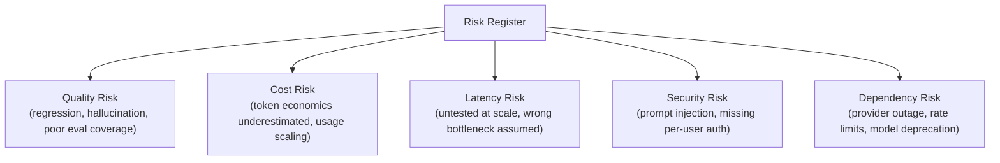

# Technical Risk Management for AI Programs

> Every AI program has a handful of risks that are entirely predictable in advance — the job is naming them before they become incidents, not explaining them after.

**Type:** Learn
**Prerequisites:** Leading Architecture Reviews for AI Systems
**Time:** ~25 minutes

## Learning Objectives

- Describe a structured approach to identifying AI-specific technical risks early in a program
- Recognize the recurring risk categories this curriculum has covered: quality, cost, latency, security, and dependency risk
- Score and prioritize risks so mitigation effort goes where it matters most
- Explain what a standard risk register practice for an AI program looks like

## What It Is

Technical risk management for AI programs means systematically identifying, in advance, the risks that recur across nearly every AI program, rather than discovering them as incidents. The central tool is a **risk register**: a tracked list of risks, each with a category, a score, an owner, and a mitigation plan.

Five categories cover most AI program surprises:

1. **Quality risk** (Levels 8-9): a prompt or model change regresses output quality without an eval gate catching it; hallucination causes user-facing harm; evaluation coverage misses a real failure mode.
2. **Cost risk** (Level 4): token economics were estimated informally; usage scales faster than projected; a longer conversation or bigger system prompt silently multiplies cost.
3. **Latency risk** (Level 8): an assumed bottleneck ("the model call is slow") proves wrong once measured, and the real one (retrieval, guardrails) was never tested at realistic scale.
4. **Security risk** (Levels 6-8): prompt injection via untrusted retrieved content; missing per-user authorization on an MCP integration; an over-privileged agent tool.
5. **Dependency risk** (Levels 0, 4, 7): a model provider's rate limits, pricing, or model versions change unexpectedly; a critical MCP server or vector database has its own outage.

## Why It Matters

A program launches an AI feature and in the first month hits three "surprises": costs are 5x higher than expected, a quality regression from an unreviewed prompt change goes unnoticed for two weeks, and a provider rate limit causes a visible outage during a traffic spike. None of these is genuinely surprising. Each is a well-known category covered in this curriculum (Levels 4 and 8). They simply were not identified and tracked before launch.

## How It Works

Each risk is scored on two dimensions: **likelihood** (1-5) and **impact** (1-5). Priority is the product of the two, and mitigation effort goes to the highest scores first rather than being spread evenly.

| Risk | Likelihood | Impact | Priority |
| :--- | :--- | :--- | :--- |
| Cost estimate is significantly wrong | 4 | 4 | 16 (high) |
| Vendor changes their logo | 3 | 1 | 3 (low) |

The process: identify risks per category, score them, assign an owner and mitigation, then review the register regularly. After any incident, add the root risk to the register so future programs inherit the lesson.

## Architecture and Workflow



```archify
src: diagrams/risk-categories.html
title: The risk register and its five risk categories
aspect: 700/592
```

1. **Identify**: walk the five categories with engineering, asking what could go wrong in each.
2. **Score**: agree likelihood and impact (1-5) as a group, not alone.
3. **Prioritize**: sort by priority; set a threshold (for example 12 or above) that requires a funded mitigation.
4. **Mitigate and assign**: each top risk has a named owner, a concrete action, and a date.
5. **Review**: revisit on a regular cadence and after every incident.

## A Real-World Example

A hypothetical AI program's register, ranked by priority:

| Rank | Category | Risk | Likelihood | Impact | Priority |
| :--- | :--- | :--- | :--- | :--- | :--- |
| 1 | Quality | No eval gate in CI/CD for prompt changes | 4 | 5 | 20 |
| 2 | Cost | Token cost estimate based on a rough guess, not measured | 4 | 4 | 16 |
| 3 | Security | MCP server uses a shared service account, no per-user auth | 3 | 5 | 15 |
| 4 | Latency | Retrieval latency untested at expected peak concurrency | 3 | 3 | 9 |
| 5 | Dependency | No fallback plan if the primary model provider has an outage | 2 | 4 | 8 |

The missing eval gate and missing per-user auth are the top concerns to mitigate first, which gives the team a defensible basis for focusing limited effort.

## What a TPM Needs to Understand

- The risks that repeatedly surprise AI programs are neither rare nor unpredictable. They fall into five well-understood categories.
- The TPM's job is to identify and score them before launch with a lightweight, prioritized register, not to let the program rediscover each as a live incident.
- Mitigation work must compete fairly against feature work. A high-priority risk (such as adding an eval gate) that is perpetually deprioritized is a risk accepted by default.
- "It hasn't caused a problem yet" is not evidence of low likelihood. A severe impact (security breach) with moderate likelihood can still score very high.

## Risks, Dependencies, and Trade-Offs

| Risk Management Approach | Predictability of Incidents | Mitigation Cost | Program Maturity Signal |
| :--- | :--- | :--- | :--- |
| **No formal risk tracking** | Low, issues arrive as surprises | Reactive, often higher (incident response) | Low |
| **One-time pre-launch risk review** | Moderate, catches known risks at launch, misses evolving ones | Moderate | Moderate |
| **Living, regularly updated risk register** | High, risks tracked and mitigated proactively | Lower overall | High |

- **Failure scenario: register as paperwork.** Scores are filled in but no owner or date exists, so nothing is mitigated.
- **Failure scenario: score inflation.** Everything is rated 4 or 5, so prioritization is meaningless. Calibrate with examples.
- **Dependency:** scoring needs honest input from engineering, security, and finance; a TPM scoring alone will miss real exposure.

## Questions to Ask Engineers

1. *"Have we explicitly identified and scored risks across all five categories (quality, cost, latency, security, dependency) for this program, or are we relying on nothing surfacing until it becomes a problem?"*
2. *"For our highest-priority identified risks, what's the specific mitigation plan, and is it actually being worked on, or just acknowledged and set aside?"*
3. *"When an unanticipated issue occurs, are we updating our risk register and process to catch similar issues earlier next time, or treating each incident as a one-off surprise?"*

## Scenario Exercise

Your program is two weeks from launching an AI assistant. The register has five risks scored as in the example above.

1. **Easy**: Which single risk has the highest priority score, and why?
2. **Medium**: Propose likelihood and impact scores (1-5 each) for a risk of your own from one of the five categories, and justify them.
3. **Hard**: A team argues the missing per-user authorization should be deprioritized because "it hasn't caused a problem yet." Using likelihood x impact, explain why that argument is weak, and say what you would propose for the launch decision.

## Key Terms

- **Risk Register**: A tracked list of identified risks, each scored and prioritized, used to guide mitigation effort.
- **Likelihood x Impact Scoring**: A simple framework for prioritizing risks by multiplying how likely they are to occur by how severe their impact would be.
- **Quality Risk, Cost Risk, Latency Risk, Security Risk, Dependency Risk**: The five recurring risk categories common across AI programs, each tied to specific concepts covered earlier in this curriculum.
