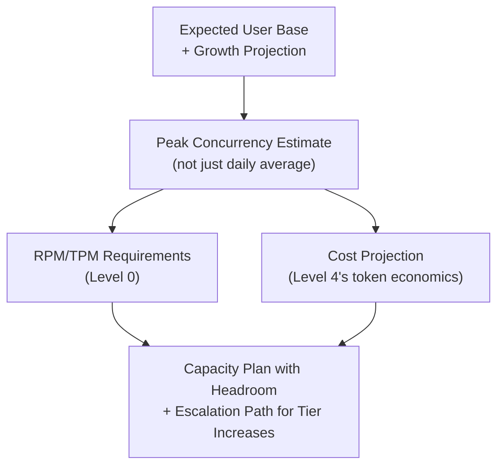

# Capacity Planning for AI Infrastructure

> "We'll scale it up if we need to" is not a capacity plan — it's a bet that nobody calculated the odds on.

**Type:** Learn
**Languages:** Python
**Prerequisites:** Technical Risk Management for AI Programs
**Time:** ~30 minutes

## Learning Objectives

- Understand capacity planning for AI systems as the combination of rate limit math (Level 0), token economics (Level 4), and traffic projections
- Recognize the specific capacity variables an AI system depends on, beyond typical server capacity planning
- Understand how to build a capacity plan that accounts for growth and traffic spikes, not just current-day averages
- Formulate the right questions when reviewing whether a launch plan's capacity assumptions are realistic

## The Problem

A team plans to launch an AI feature to their full user base of 200,000 users. Their capacity plan is a single sentence: "our current API tier should be fine." When asked what "fine" means in RPM/TPM terms (Level 0) at expected concurrency, or what happens during a traffic spike (e.g. a marketing email driving a surge), there's no answer — the plan was an assumption, not a calculation, and it fails within hours of a real launch.

## The Concept

Capacity planning for an AI system combines several distinct calculations this curriculum has already covered individually, brought together into one forward-looking projection.



### Peak Concurrency, Not Daily Average

A daily average of "1,000 requests per day" hides enormous variation — if most usage clusters in a 2-hour peak window, actual concurrent load during that window could be 10x the naive average-per-hour figure. Capacity planning must estimate **peak concurrency**, not just total daily volume, since rate limits (Level 0) are enforced per-minute, not per-day.

### RPM/TPM Requirements at Peak

Using the peak concurrency estimate, calculate the actual RPM and TPM requirements (Level 0) needed to serve that load without hitting provider rate limits — and compare this against the current API tier's actual limits, not an assumption that "it should be fine."

### Cost Projection at Scale

Using token economics (Level 4), project total cost at the expected peak and average usage levels — a capacity plan without a cost projection is incomplete, since infrastructure capacity and cost are two sides of the same scaling question.

### Headroom and Escalation Path

A responsible capacity plan includes headroom (e.g. planning for 150% of the projected peak, not exactly 100%) and a concrete escalation path — who to contact, how long a rate/tier increase request typically takes with the provider — for when real usage exceeds projections, rather than discovering the escalation process for the first time during an actual capacity crisis.

## Build It

A simplified capacity planning calculator combining peak concurrency, rate limit requirements, and cost projection:

```python
def capacity_plan(
    total_users,
    percent_active_daily=0.30,
    requests_per_active_user_per_day=3,
    peak_concentration_factor=8,
    avg_tokens_per_request=1500,
    price_per_1k_tokens=0.004,
    current_tpm_limit=200_000,
):
    active_users = total_users * percent_active_daily
    daily_requests = active_users * requests_per_active_user_per_day

    avg_requests_per_minute = daily_requests / (24 * 60)
    peak_requests_per_minute = avg_requests_per_minute * peak_concentration_factor

    peak_tpm_needed = peak_requests_per_minute * avg_tokens_per_request
    headroom_tpm_needed = peak_tpm_needed * 1.5

    daily_cost = (daily_requests * avg_tokens_per_request / 1000) * price_per_1k_tokens

    print(f"Total users: {total_users:,}")
    print(f"Estimated daily requests: {daily_requests:,.0f}")
    print(f"Average RPM: {avg_requests_per_minute:.1f}")
    print(f"Estimated PEAK RPM (concentration factor {peak_concentration_factor}x): {peak_requests_per_minute:.1f}")
    print(f"Peak TPM needed: {peak_tpm_needed:,.0f}")
    print(f"Recommended capacity with 50% headroom: {headroom_tpm_needed:,.0f} TPM")
    print(f"Current provider TPM limit: {current_tpm_limit:,}")

    if headroom_tpm_needed > current_tpm_limit:
        shortfall = headroom_tpm_needed - current_tpm_limit
        print(f"\nGAP DETECTED: current limit is short by {shortfall:,.0f} TPM.")
        print("ACTION REQUIRED: request a tier increase before launch, not after hitting the limit.")
    else:
        print("\nCurrent limit appears sufficient with recommended headroom.")

    print(f"\nProjected daily cost: ${daily_cost:,.2f}")

capacity_plan(total_users=200_000)
```

Running this reveals a concrete gap and a specific required action (requesting a tier increase before launch) — a fundamentally different, defensible position than the opening scenario's "our current tier should be fine."

## Use It

Mature AI programs treat capacity planning as a required, calculated deliverable before any significant launch:

- **Launch readiness reviews requiring a capacity plan document**, with the specific numbers shown above, not a verbal assurance.
- **Provider tier increase requests submitted well in advance of launch**, given that these often have real processing lead times that can't be compressed under launch-day pressure.
- **Load testing against realistic peak concurrency estimates**, not just average daily volume, to validate the capacity plan's assumptions before real users are affected.

## Exercises

1. **Easy**: In the code above, what does the "peak_concentration_factor" represent, and why is it higher than 1?
2. **Medium**: Explain in plain English why "our daily average is well within limits" doesn't guarantee a launch won't hit rate limits.
3. **Hard**: Propose a specific headroom percentage and escalation plan for a launch you expect to have unusually unpredictable traffic (e.g. a feature announced in a viral social media post), and justify your choices.

## TPM Perspective

### Strategic Executive Summary
A capacity plan that isn't backed by a calculation — peak concurrency, RPM/TPM requirements, cost projection, and headroom — is an assumption dressed up as a plan, and it tends to fail exactly when it matters most: during a real launch or a traffic spike. A TPM should require a specific, numbers-based capacity plan document before any significant AI feature launch, the same way a traditional infrastructure launch would require load testing and capacity sign-off.

### Questions to Challenge Engineering
1. *"What's our peak concurrency estimate, not just our daily average, and what RPM/TPM does that require compared to our current provider tier?"*
2. *"Have we requested any necessary tier increases well before launch, given that these often have real processing lead times?"*
3. *"What headroom are we building in above our peak estimate, and what's our escalation plan if real traffic exceeds even that?"*

### Trade-Off Matrix

| Capacity Planning Approach | Launch Risk | Preparation Effort | Cost Predictability |
| :--- | :--- | :--- | :--- |
| **"Should be fine" assumption, no calculation** | High — likely to hit limits under real load | Minimal | Low, surprises common |
| **Daily average calculation only** | Moderate — misses peak concentration risk | Low-Moderate | Moderate |
| **Peak concurrency + RPM/TPM + cost + headroom** | Low — planned for realistic worst case | Higher, but front-loaded | High, defensible projection |

## Key Terms

- **Peak Concurrency**: The maximum simultaneous load a system experiences, often far higher than a naive daily-average calculation would suggest.
- **Peak Concentration Factor**: A multiplier representing how much traffic clusters into peak windows compared to a flat daily average.
- **Headroom**: Extra capacity planned above the projected peak requirement, to absorb unexpected traffic beyond estimates.
- **Escalation Path**: A predefined process for requesting additional capacity (e.g. a provider rate limit tier increase) when real usage exceeds projections.
