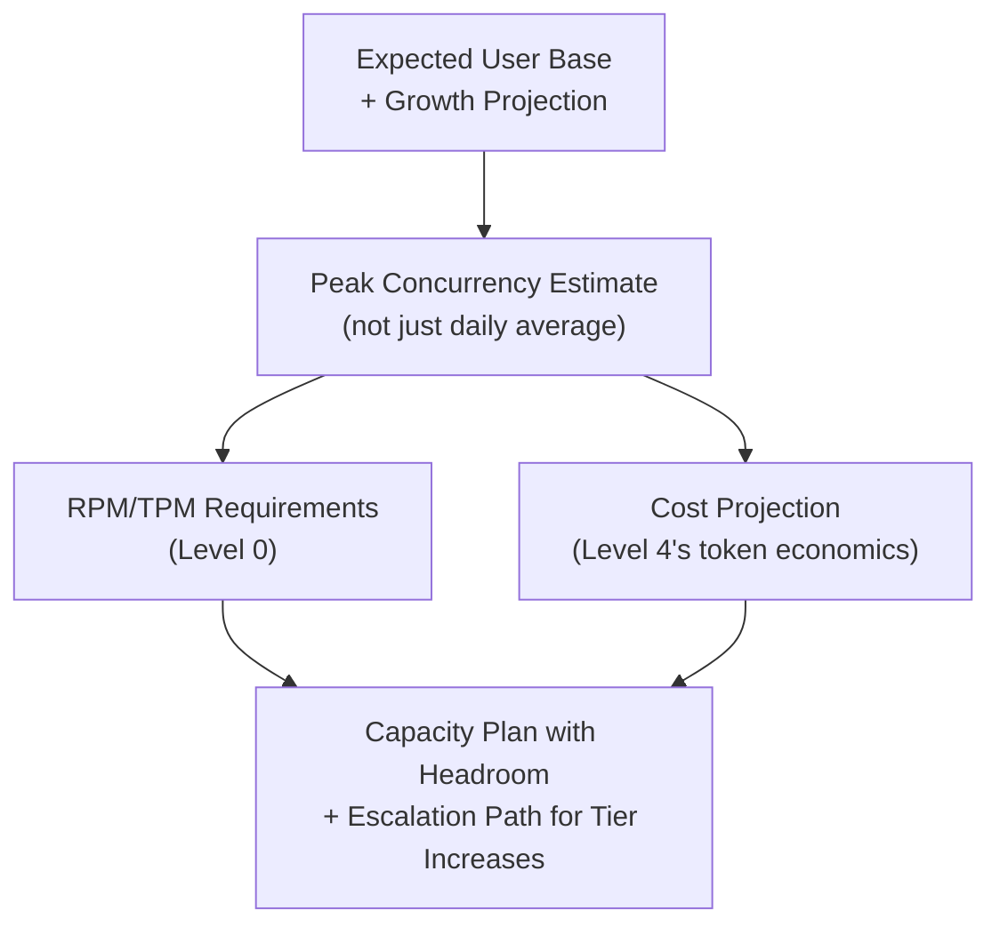

# Capacity Planning for AI Infrastructure

> "We'll scale it up if we need to" is not a capacity plan — it's a bet that nobody calculated the odds on.

**Type:** Learn
**Prerequisites:** Technical Risk Management for AI Programs
**Time:** ~25 minutes

## Learning Objectives

- Explain capacity planning for AI systems as the combination of rate limit math (Level 0), token economics (Level 4), and traffic projections
- Recognize the specific capacity variables an AI system depends on, beyond typical server capacity planning
- Describe how a capacity plan accounts for growth and traffic spikes, not just current-day averages
- Ask the right questions when reviewing whether a launch plan's capacity assumptions are realistic

## What It Is

Capacity planning for an AI system combines several calculations this curriculum has covered individually into one forward-looking projection: how many users, how much of that load arrives at peak, how many requests and tokens per minute that implies, whether the provider's limits allow it, and what it costs.



```archify
src: diagrams/capacity-plan-flow.html
title: From user base to a capacity plan with headroom
aspect: 1270/348
```

## Why It Matters

A team plans to launch an AI feature to its full base of 200,000 users. The capacity plan is one sentence: "our current API tier should be fine." Asked what "fine" means in RPM/TPM terms at expected concurrency, or what happens when a marketing email drives a surge, there is no answer. The plan was an assumption, not a calculation, and it fails within hours of a real launch.

## How It Works

1. **Peak concurrency, not daily average.** A daily average hides variation. If most usage clusters in a 2-hour window, load in that window can be many times the flat average. Provider rate limits are enforced per minute, not per day, so the peak is what matters. A **peak concentration factor** (for example 8x) captures this.
2. **RPM/TPM at peak.** Convert the peak into requests per minute and tokens per minute, then compare against the current tier's actual limits, not an assumption.
3. **Cost at scale.** Use token economics to project cost at average and peak usage. Capacity and cost are two sides of the same scaling question.
4. **Headroom and escalation.** Plan for more than 100% of the projected peak (for example 150%) and know in advance who to contact and how long a tier increase takes, instead of learning the process during a crisis.

## Architecture and Workflow

1. Estimate active users and requests per active user per day.
2. Divide daily requests by minutes in a day to get average RPM; multiply by the concentration factor to get peak RPM.
3. Multiply peak RPM by average tokens per request to get peak TPM; multiply by 1.5 for headroom.
4. Compare to the provider tier's TPM limit; if short, submit a tier increase request before launch.
5. Project daily cost; validate assumptions with a load test at the peak estimate.

## A Real-World Example

Launching to 200,000 users, assuming 30% active daily, 3 requests per active user per day, a peak concentration factor of 8, 1,500 tokens per request, a price of $0.004 per 1,000 tokens, and a current limit of 200,000 TPM:

| Step | Calculation | Result |
| :--- | :--- | :--- |
| Active users per day | 200,000 x 30% | 60,000 |
| Daily requests | 60,000 x 3 | 180,000 |
| Average RPM | 180,000 / 1,440 minutes | 125 |
| Peak RPM | 125 x 8 | 1,000 |
| Peak TPM needed | 1,000 x 1,500 | 1,500,000 |
| With 50% headroom | 1,500,000 x 1.5 | 2,250,000 |
| Current provider limit | Given | 200,000 |
| Shortfall | 2,250,000 - 200,000 | about 2,050,000 TPM (over 11x) |
| Daily cost | 180,000 x 1.5 thousand tokens x $0.004 | about $1,080 per day |

The calculation exposes a gap an order of magnitude wide and a specific action: request a tier increase before launch. That is a defensible position, unlike "our current tier should be fine."

## What a TPM Needs to Understand

- A capacity plan not backed by a calculation (peak concurrency, RPM/TPM, cost, headroom) is an assumption dressed up as a plan.
- Require a numbers-based capacity document before any significant AI launch, as you would require load testing and capacity sign-off for traditional infrastructure.
- Tier increases have real lead times that cannot be compressed on launch day. Start early.
- Concentration factor and tokens per request are the most sensitive assumptions. Ask where each came from (measured, or guessed).
- Capacity and cost move together. A fix for one (bigger tier) usually changes the other.

## Risks, Dependencies, and Trade-Offs

| Capacity Planning Approach | Launch Risk | Preparation Effort | Cost Predictability |
| :--- | :--- | :--- | :--- |
| **"Should be fine" assumption, no calculation** | High, likely to hit limits under real load | Minimal | Low, surprises common |
| **Daily average calculation only** | Moderate, misses peak concentration risk | Low-Moderate | Moderate |
| **Peak concurrency + RPM/TPM + cost + headroom** | Low, planned for realistic worst case | Higher, but front-loaded | High, defensible projection |

- **Dependency:** the model provider's tier approval process and its lead time; any second provider used as a fallback.
- **Failure scenario: viral spike.** Traffic exceeds even the headroom; requests are throttled and users see errors. Mitigation: queueing, graceful degradation, a pre-agreed escalation contact.
- **Failure scenario: prompt growth.** A longer system prompt raises tokens per request, silently pushing TPM over the limit even with flat traffic.
- **Trade-off:** more headroom means safer launches but a higher committed tier cost.

## Questions to Ask Engineers

1. *"What's our peak concurrency estimate, not just our daily average, and what RPM/TPM does that require compared to our current provider tier?"*
2. *"Have we requested any necessary tier increases well before launch, given that these often have real processing lead times?"*
3. *"What headroom are we building in above our peak estimate, and what's our escalation plan if real traffic exceeds even that?"*

## Scenario Exercise

You are the TPM for the 200,000-user launch above.

1. **Easy**: What does the peak concentration factor represent, and why is it higher than 1?
2. **Medium**: Explain in plain English why "our daily average is well within limits" does not guarantee the launch will avoid rate limits.
3. **Hard**: The feature may be announced in a viral social media post. Propose a headroom percentage and escalation plan, and justify your choices, including what you would do if the provider cannot approve the increase in time.

## Key Terms

- **Peak Concurrency**: The maximum simultaneous load a system experiences, often far higher than a naive daily-average calculation would suggest.
- **Peak Concentration Factor**: A multiplier representing how much traffic clusters into peak windows compared to a flat daily average.
- **Headroom**: Extra capacity planned above the projected peak requirement, to absorb unexpected traffic beyond estimates.
- **Escalation Path**: A predefined process for requesting additional capacity (e.g. a provider rate limit tier increase) when real usage exceeds projections.
