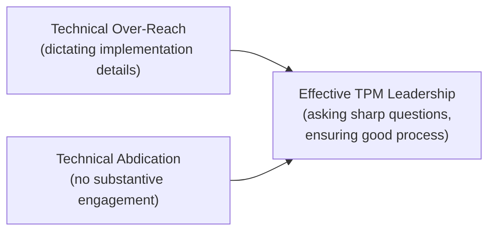

# Engineering Leadership for AI Teams

> Your job isn't to be the smartest person in the review — it's to be the person who makes sure the right questions get asked before the wrong decision gets made.

**Type:** Learn
**Prerequisites:** Capacity Planning for AI Infrastructure
**Time:** ~25 minutes

## Learning Objectives

- Describe the leadership posture an AI TPM needs: technically fluent enough to ask sharp questions, without needing to write the code
- Recognize how to build technical credibility with an engineering team without overstepping into their decisions
- Explain how to balance moving fast with the AI-specific risks this curriculum has covered
- Reflect on how the full curriculum equips a TPM to lead AI programs effectively, from foundations through production

## What It Is

Effective AI TPM leadership sits deliberately between two failure modes: **technical over-reach** (dictating implementation) and **technical abdication** (never engaging with substance). The goal is asking sharp, well-informed questions and ensuring good decisions get made, not personally making every technical decision.



```archify
src: diagrams/tpm-leadership-balance.html
title: Effective TPM leadership sits between over-reach and abdication
aspect: 740/308
```

## Why It Matters

A newly promoted AI TPM, eager to prove credibility, starts dictating choices to the team: "use this embedding model," "structure the agent loop this way." The team lacks nothing but context on what was already considered and rejected, and it disengages, feeling micromanaged. The opposite failure is just as damaging: a TPM who defers on everything technical and cannot push back when a team proposes something with a foreseeable, avoidable risk.

## How It Works

**What "sharp questions" look like.** Every lesson in this curriculum modeled the pattern: understand a concept well enough to recognize when a design choice, cost estimate, or quality claim does not hold up, then ask the specific question that surfaces the gap. Examples: "is this a retrieval failure or a generation failure," "have we measured peak concurrency," "does this guardrail enforce the rule deterministically or just prompt for it."

**Building credibility without overstepping.**

- **Ask, don't dictate.** "Walk me through why we chose this chunking strategy" builds trust and surfaces reasoning; "use fixed-size chunking instead" overrides expertise without context.
- **Defer on how, own the outcome.** The team decides how to build it; the TPM ensures the right questions were asked and risks identified before it ships.
- **Learn continuously and visibly.** A TPM who keeps learning and asks better questions over time earns more credibility than one who claims false expertise.

**Balancing speed with risk.** Not every risk needs to block every decision. An early prototype can accept more risk (no eval gate yet, no per-user auth yet) than a system handling real customer data at scale. Calibrate which risks are acceptable to defer and which are non-negotiable, based on stakes, not a rigid checklist.

## Architecture and Workflow

Risk calibration uses three factors: program stage, data sensitivity, and user scale. Points are added for each, and the total sets urgency.

| Factor | Condition | Points |
| :--- | :--- | :--- |
| Program stage | Prototype / Pilot / General availability | 1 / 2 / 4 |
| Sensitive data | Handled | 3 |
| User scale | Small / Large | 1 / 3 |

Total 7 or more: launch-blocking. Total 4 to 6: high priority, resolve soon and track. Below 4: acceptable to defer, track in the register and revisit at the next stage.

## A Real-World Example

The same risk class can land very differently depending on context.

| Risk | Stage | Sensitive data | Scale | Score | Decision |
| :--- | :--- | :--- | :--- | :--- | :--- |
| No eval gate in CI/CD | Prototype (1) | No (0) | Small (1) | 2 | Acceptable to defer; track in register |
| MCP server uses shared service account, no per-user auth | General availability (4) | Yes (3) | Large (3) | 10 | Launch-blocking |

A missing eval gate is reasonably deferrable for a small internal prototype but launch-blocking for a general-availability feature touching sensitive data at scale. In practice this posture shows up in architecture reviews (sharp questions rather than rubber-stamping), risk management (calibrated urgency), and day-to-day relationships (questions that demonstrably improve outcomes).

## What a TPM Needs to Understand

- This curriculum exists to build one fluency: enough technical understanding to ask precise questions and calibrate real risk without implementing the solution. That is the AI TPM's distinct value, different from an engineer's implementation depth and a product manager's feature focus.
- Decide who owns what: engineering owns the how; the TPM owns that the right questions and risks were surfaced.
- Calibration must be explicit and written down. "We accepted this risk at prototype stage" becomes "this blocks GA" on a known trigger.
- Credibility is earned by questions that improve outcomes, not by claiming expertise.

## Risks, Dependencies, and Trade-Offs

| Leadership Posture | Team Trust | Risk Coverage | Program Speed |
| :--- | :--- | :--- | :--- |
| **Technical over-reach (dictating solutions)** | Low, team feels micromanaged | Inconsistent, depends on TPM's own expertise gaps | Slower, friction and disengagement |
| **Technical abdication (no substantive engagement)** | High short-term, but risk-blind | Low, no one asks the hard questions | Fast short-term, risky long-term |
| **Sharp questions + calibrated risk urgency** | High, team feels supported, not overridden | High, systematic and prioritized | Balanced, fast where safe, careful where it matters |

- **Dependency:** trust and access. A TPM who is not in design conversations early cannot ask questions in time.
- **Failure scenario: deferred risk never revisited.** A prototype risk is accepted and never re-scored as the program moves to pilot and GA. Mitigation: re-score at every stage gate.

## Questions to Ask Engineers

1. *"Am I asking questions that surface real risks and trade-offs, or am I dictating implementation choices the team is better positioned to make?"* (a self-check)
2. *"For this specific risk, given our current program stage and stakes, is this genuinely launch-blocking, or reasonable to defer and track explicitly?"*
3. *"Is my technical engagement with this team building trust and better outcomes over time, or is it being perceived as either overstepping or absent?"*

## Scenario Exercise

Your team is moving a pilot AI assistant to general availability next quarter. It will now read customer records.

1. **Easy**: Describe in one sentence each what technical over-reach and technical abdication look like in practice.
2. **Medium**: Using the calibration table, explain why missing per-user authorization had a low urgency at the prototype stage but would be launch-blocking now.
3. **Hard**: Reflecting on the whole curriculum, pick three concepts you now feel equipped to question in a real engineering conversation, and write the question you would ask for each.

## Key Terms

- **Technical Over-Reach**: A TPM dictating specific implementation decisions rather than asking questions and trusting engineering expertise.
- **Technical Abdication**: A TPM disengaging from technical substance entirely, unable to identify or challenge foreseeable risks.
- **Risk Calibration**: Adjusting how urgently a given risk must be addressed based on actual program stage and stakes, rather than applying uniform rigor regardless of context.
- **Sharp Questions**: Precise, well-informed questions that surface real gaps or risks, built from genuine technical understanding rather than generic skepticism.
