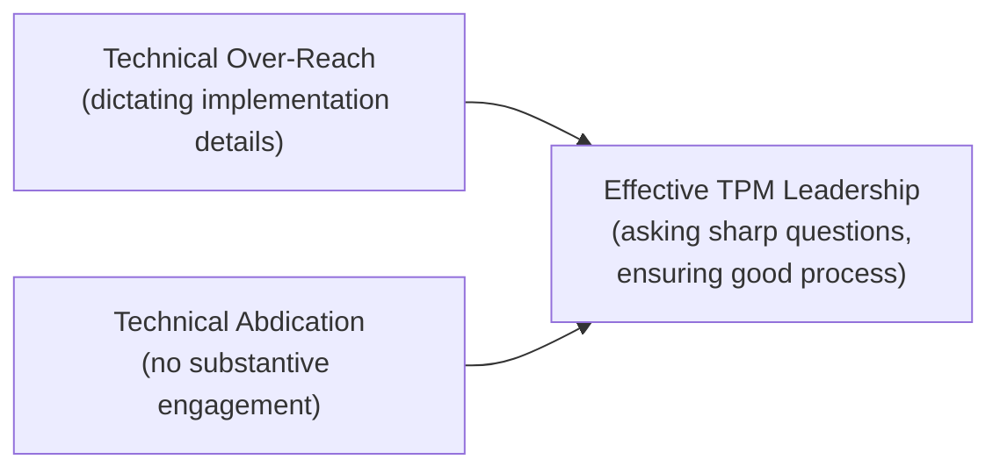

# Engineering Leadership for AI Teams

> Your job isn't to be the smartest person in the review — it's to be the person who makes sure the right questions get asked before the wrong decision gets made.

**Type:** Learn
**Languages:** Concept
**Prerequisites:** Capacity Planning for AI Infrastructure
**Time:** ~30 minutes

## Learning Objectives

- Understand the specific leadership posture an AI TPM needs: technically fluent enough to ask sharp questions, without needing to write the code
- Recognize how to build technical credibility with an engineering team without overstepping into their decisions
- Understand how to balance moving fast with the AI-specific risks this curriculum has covered
- Reflect on how the full curriculum equips a TPM to lead AI programs effectively, from foundations through production

## The Problem

A newly promoted AI TPM, eager to prove technical credibility, starts dictating specific implementation choices to the engineering team — "use this embedding model," "structure the agent loop this way" — without the team's context on trade-offs already considered and rejected. The team disengages, feeling micromanaged by someone who, however well-intentioned, is overstepping a role boundary. The opposite failure is just as damaging: a TPM who defers entirely on anything technical, unable to push back when a team proposes something with a foreseeable, avoidable risk.

## The Concept

Effective AI TPM leadership sits deliberately between two failure modes: technical over-reach (dictating implementation) and technical abdication (never engaging with substance) — the goal is asking sharp, well-informed questions and ensuring good decisions get made, not personally making every technical decision.



### What "Asking Sharp Questions" Actually Looks Like

Every lesson in this curriculum modeled this pattern explicitly: understand a concept well enough to recognize when a design choice, cost estimate, or quality claim doesn't hold up, and ask the specific, informed question that surfaces the gap — "is this a retrieval failure or a generation failure," "have we measured peak concurrency," "does this guardrail enforce the rule deterministically or just prompt for it." This is the core skill this entire course was built to develop.

### Building Technical Credibility Without Overstepping

- **Ask, don't dictate**: "walk me through why we chose this chunking strategy" builds trust and surfaces reasoning; "use fixed-size chunking instead" overrides expertise without full context.
- **Defer to implementation expertise, own the outcome accountability**: the team decides *how* to build it; the TPM ensures the *right questions* were asked and *risks* were identified before it ships.
- **Learn continuously, visibly**: an AI TPM who keeps learning (this curriculum being one example) and asks better questions over time earns more credibility than one who claims false expertise upfront.

### Balancing Speed With Risk

Not every risk identified in this curriculum needs to block every decision — an early-stage prototype reasonably accepts more risk (no eval gate yet, no per-user auth yet) than a system handling real customer data at scale. Effective leadership means calibrating which risks are acceptable to defer and which are non-negotiable before launch, based on actual stakes, not a rigid one-size-fits-all checklist applied identically to every situation.

## Build It

A simplified framework for calibrating which risks from the risk management lesson are launch-blocking versus acceptable to defer, based on program stage and stakes:

```python
def calibrate_risk_urgency(risk_description, program_stage, handles_sensitive_data, user_facing_scale):
    urgency_score = 0

    if program_stage == "prototype":
        urgency_score += 1
    elif program_stage == "pilot":
        urgency_score += 2
    elif program_stage == "general_availability":
        urgency_score += 4

    if handles_sensitive_data:
        urgency_score += 3

    if user_facing_scale == "large":
        urgency_score += 3
    elif user_facing_scale == "small":
        urgency_score += 1

    if urgency_score >= 7:
        recommendation = "LAUNCH-BLOCKING: must resolve before proceeding"
    elif urgency_score >= 4:
        recommendation = "HIGH PRIORITY: resolve soon, track explicitly"
    else:
        recommendation = "ACCEPTABLE TO DEFER: track in risk register, revisit at next stage"

    print(f"Risk: {risk_description}")
    print(f"  Stage: {program_stage}, sensitive data: {handles_sensitive_data}, scale: {user_facing_scale}")
    print(f"  Urgency score: {urgency_score} -> {recommendation}\n")

calibrate_risk_urgency(
    "No eval gate in CI/CD",
    program_stage="prototype", handles_sensitive_data=False, user_facing_scale="small",
)

calibrate_risk_urgency(
    "MCP server uses shared service account, no per-user auth",
    program_stage="general_availability", handles_sensitive_data=True, user_facing_scale="large",
)
```

This gives a defensible, calibrated basis for "which risks block this specific launch" — the same missing eval gate risk is reasonably deferrable for a small internal prototype, but launch-blocking for a general-availability feature touching sensitive data at scale.

## Use It

Effective AI TPMs apply this leadership posture across every stage of a program:

- **In architecture reviews** (this level's first lesson): facilitating with sharp, informed questions rather than either rubber-stamping or dictating solutions.
- **In risk management** (this level's second lesson): calibrating urgency based on actual stakes rather than applying identical rigor to every risk regardless of context.
- **In day-to-day engineering relationships**: earning trust by asking questions that demonstrably improve outcomes, building a reputation as someone whose technical involvement makes the program better, not slower.

## Exercises

1. **Easy**: Describe, in one sentence each, what "technical over-reach" and "technical abdication" look like in practice.
2. **Medium**: Using the calibration framework above, explain why the same identified risk (e.g. missing per-user auth) could reasonably have very different urgency scores at different program stages.
3. **Hard**: Reflecting on this entire curriculum, identify three specific concepts (from any level) you now feel equipped to ask a sharp, informed question about in a real engineering conversation, and write out what that question would be.

## TPM Perspective

### Strategic Executive Summary
This entire curriculum — from CPU/GPU fundamentals through production operations to product management and program leadership — exists to build exactly the fluency this final lesson describes: enough technical understanding to ask precise, well-informed questions and calibrate real risk, without needing to personally implement the solution. That is the specific, valuable role an AI TPM plays, distinct from both an engineer's implementation expertise and a general product manager's feature-level focus.

### Questions to Challenge Engineering
1. *"Am I asking questions that surface real risks and trade-offs, or am I dictating implementation choices the team is better positioned to make?"*
2. *"For this specific risk, given our current program stage and stakes, is this genuinely launch-blocking, or reasonable to defer and track explicitly?"*
3. *"Is my technical engagement with this team building trust and better outcomes over time, or is it being perceived as either overstepping or absent?"*

### Trade-Off Matrix

| Leadership Posture | Team Trust | Risk Coverage | Program Speed |
| :--- | :--- | :--- | :--- |
| **Technical over-reach (dictating solutions)** | Low — team feels micromanaged | Inconsistent — depends on TPM's own expertise gaps | Slower — friction and disengagement |
| **Technical abdication (no substantive engagement)** | High short-term, but risk-blind | Low — no one is asking the hard questions | Fast short-term, risky long-term |
| **Sharp questions + calibrated risk urgency** | High — team feels supported, not overridden | High — systematic, prioritized | Balanced — fast where safe, careful where it matters |

## Key Terms

- **Technical Over-Reach**: A TPM dictating specific implementation decisions rather than asking questions and trusting engineering expertise.
- **Technical Abdication**: A TPM disengaging from technical substance entirely, unable to identify or challenge foreseeable risks.
- **Risk Calibration**: Adjusting how urgently a given risk must be addressed based on actual program stage and stakes, rather than applying uniform rigor regardless of context.
- **Sharp Questions**: Precise, well-informed questions that surface real gaps or risks, built from genuine technical understanding rather than generic skepticism.
