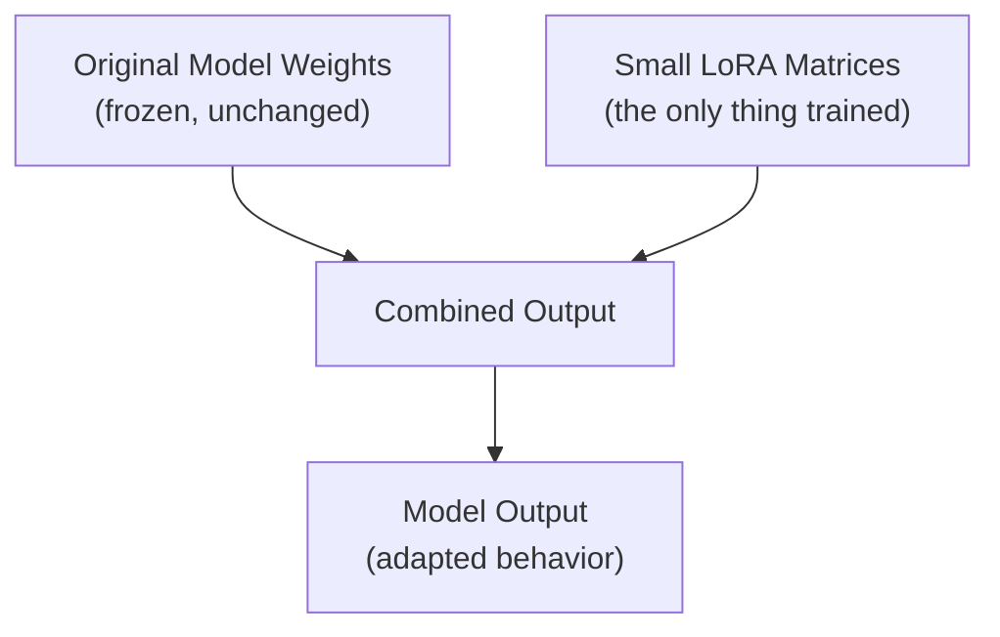

# Parameter-Efficient Fine-Tuning: LoRA and QLoRA

> LoRA doesn't retrain the model — it adds a small, learnable "adjustment layer" on top and leaves the original weights untouched.

**Type:** Learn
**Prerequisites:** Engineering Leadership for AI Teams
**Time:** ~25 minutes

## Learning Objectives

- Explain why full fine-tuning of a large model is expensive, and what problem LoRA solves
- Describe the mechanical idea behind LoRA: training small additional matrices instead of all original weights
- Explain what QLoRA adds on top: quantization for further memory savings
- Ask the right questions when a team proposes a fine-tuning approach and cost estimate

## What It Is

**LoRA (Low-Rank Adaptation)** is a parameter-efficient fine-tuning technique. Instead of updating all of a model's original weights, it freezes them entirely and trains a small set of additional matrices alongside each targeted layer. At run time the frozen model and the small additions work together to produce adapted behavior.

**QLoRA** combines LoRA with **quantization**: the frozen base weights are stored in a compressed, lower-precision format (for example 4-bit instead of 16-bit), which cuts the memory needed just to load the base model for training.

The enabling insight is **low-rank structure**: the change needed to adapt a model to a specific task can often be described with far fewer numbers than the full weight matrices contain. Training only that small change captures most of the benefit of full fine-tuning at a fraction of the trainable parameter count.

## Why It Matters

A team wants to fine-tune a 70-billion-parameter model for a specialized customer service tone. Full fine-tuning means updating all 70 billion parameters, and the GPU must hold weights plus gradients plus optimizer states for every one of them (the memory hierarchy lesson). That implies a multi-GPU cluster and a training run costing tens of thousands of dollars, for a task that needs a fairly narrow behavioral adjustment, not a re-learning of the whole language.

## How It Works

1. The base model is loaded and frozen: none of its weights change.
2. Small adapter matrices are attached to selected layers. Their size is controlled by the **rank**; a lower rank means fewer trainable numbers.
3. Training updates only the adapter matrices. Memory is needed mainly for the frozen weights plus a small amount of gradient and optimizer state.
4. In QLoRA, the frozen weights are held in 4-bit precision during training, while the adapters train in higher precision.
5. The result is a small adapter file. It can be loaded on top of the shared base model, or swapped for a different adapter.

Because the original weights never change, LoRA is also safer against **catastrophic forgetting**, where fine-tuning damages the base model's general abilities.

## Architecture and Workflow



```archify
src: diagrams/lora-combined-output.html
title: Frozen weights plus small LoRA matrices
aspect: 910/308
```

## A Real-World Example

Fine-tuning a 70B-parameter model with 80 layers. Figures are rough planning estimates; real numbers vary with the setup.

**Trainable parameters.** In a simplified LoRA setup with rank 8 and a layer width of 4,096, each layer adds about 2 x 4,096 x 8 = 65,536 trainable numbers. Across 80 layers that is about 5.2 million parameters, roughly 0.0075% of 70 billion, or over 13,000x fewer than full fine-tuning. (Real setups target several matrices per layer and typically land between 0.1% and 1%, still a huge reduction.)

**GPU memory.**

| Approach | Memory driver | Rough estimate for 70B | Typical hardware |
| :--- | :--- | :--- | :--- |
| Full fine-tuning | Weights + gradients + optimizer states, about 16 bytes per parameter | About 1.1 TB | 16 or more high-end GPUs |
| LoRA (16-bit frozen base) | Frozen weights at 2 bytes per parameter, plus small adapter state | About 140 GB plus overhead | 2 to 4 high-end GPUs |
| QLoRA (4-bit frozen base) | Frozen weights at 0.5 bytes per parameter | About 35 GB plus overhead | One 48 to 80 GB GPU |

Teams typically use these in three ways: task-specific adaptation (tone, format, narrow domain), many adapters on one shared base (for example 5 customer segments, 5 small adapter files instead of 5 full 140 GB model copies), and QLoRA for resource-constrained teams.

## What a TPM Needs to Understand

- LoRA and QLoRA are the sensible default for most fine-tuning projects. They reduce cost and hardware needs dramatically while capturing most of the benefit for behavioral and style adaptation.
- A proposal for full fine-tuning of a large model should arrive with a specific justification for why LoRA or QLoRA would not be enough, given the order-of-magnitude cost difference.
- Fine-tuning teaches behavior (tone, format, specialization), not new facts reliably. If the need is fresh knowledge, retrieval is usually the better tool.
- Adapters turn a multi-model problem into a one-base-model plus many-small-files problem, which changes serving, versioning, and storage plans.
- Ask for the quality comparison, not only the cost one: the cheaper method must be evaluated on the same test set.

## Risks, Dependencies, and Trade-Offs

| Approach | Trainable Parameters | VRAM/Compute Cost | Best For |
| :--- | :--- | :--- | :--- |
| **Full fine-tuning** | 100% of model | Very high | Rare cases needing deep, broad changes to model behavior |
| **LoRA** | Often <1% of model | Low | Most task-specific behavioral/style adaptation |
| **QLoRA** | Often <1% of model | Lowest (quantized base + LoRA) | Resource-constrained fine-tuning of large models |

- **Dependencies:** a high-quality, representative training dataset; an evaluation set to compare against the untuned baseline; the license of the base model.
- **Failure scenario: narrow overfit.** The adapter learns the training examples but fails on real traffic. Mitigation: hold-out evaluation.
- **Failure scenario: quantization quality loss.** 4-bit loading can slightly lower quality; validate before committing.
- **Failure scenario: base model upgrade.** Adapters are tied to the exact base model; a new base version means retraining.
- **Trade-off:** lower rank is cheaper but may under-fit complex behavior; higher rank costs more.

## Questions to Ask Engineers

1. *"Have we considered LoRA or QLoRA instead of full fine-tuning, and if we're proposing full fine-tuning anyway, what specifically requires updating all of the model's original weights?"*
2. *"What's the actual VRAM and cost difference between our proposed approach and a LoRA/QLoRA alternative, given the typical order-of-magnitude reduction in trainable parameters?"*
3. *"If we need multiple specialized behaviors, are we planning to train separate LoRA adapters on one shared base model, rather than maintaining multiple full fine-tuned copies?"*

## Scenario Exercise

Your team plans to fine-tune a 70B model for five customer segments, each with its own tone and policies.

1. **Easy**: Roughly what share of the model's parameters does LoRA train in the example above, and why does it matter for cost?
2. **Medium**: Explain in plain English why keeping the original weights frozen makes LoRA both cheaper and safer against catastrophic forgetting.
3. **Hard**: Compare supporting the five segments with five fully fine-tuned model copies versus one base model with five adapters. Cover memory, cost, deployment, and what happens when the base model is upgraded.

## Key Terms

- **LoRA (Low-Rank Adaptation)**: A parameter-efficient fine-tuning technique that freezes original model weights and trains small additional matrices instead.
- **QLoRA**: LoRA combined with quantization of the frozen base model weights, further reducing memory requirements for fine-tuning.
- **Low-Rank Approximation**: The mathematical insight that a needed weight adjustment can often be represented by a much smaller set of numbers than the full weight matrices.
- **Adapter**: A small, trained LoRA module that can be applied to (or swapped out from) a shared frozen base model for a specific task or behavior.
