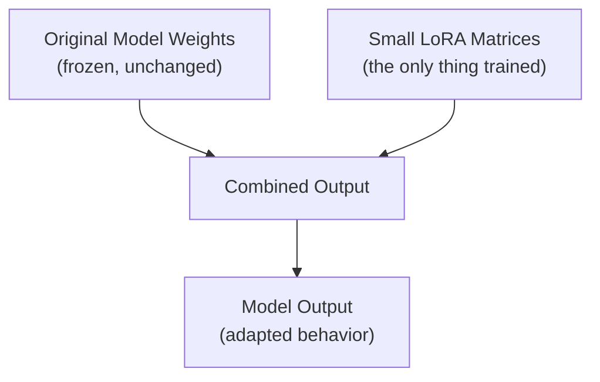

# Parameter-Efficient Fine-Tuning: LoRA and QLoRA

> LoRA doesn't retrain the model — it adds a small, learnable "adjustment layer" on top and leaves the original weights untouched.

**Type:** Learn
**Languages:** Python, Concept
**Prerequisites:** Engineering Leadership for AI Teams
**Time:** ~30 minutes

## Learning Objectives

- Understand why full fine-tuning of a large model is expensive, and what problem LoRA solves
- Understand the mechanical idea behind LoRA: training small additional matrices instead of all original weights
- Understand what QLoRA adds on top: quantization for further memory savings
- Formulate the right questions when a team proposes a fine-tuning approach and cost estimate

## The Problem

A team wants to fine-tune a 70-billion-parameter model for a specialized customer service tone. Full fine-tuning would mean updating all 70 billion parameters, requiring enormous GPU memory (recalling the memory hierarchy lesson: model weights plus gradients plus optimizer states for every parameter) and a training run costing tens of thousands of dollars — for a task that arguably needs to teach a fairly narrow behavioral adjustment, not relearn the whole language.

## The Concept

**LoRA (Low-Rank Adaptation)** is a parameter-efficient fine-tuning technique: instead of updating all of a model's original weights, it freezes them entirely and trains a small set of additional matrices alongside each targeted layer, dramatically reducing the number of trainable parameters.



### Why This Works: Low-Rank Structure

The key mathematical insight behind LoRA is that the *change* needed to adapt a model for a specific task can often be represented by a much smaller set of numbers than the full weight matrices themselves — a "low-rank" approximation of the needed adjustment. Training only this small addition, while keeping the original weights frozen, captures most of the benefit of full fine-tuning at a small fraction of the trainable parameter count (often under 1% of the original model's parameters).

### QLoRA: Adding Quantization

**QLoRA** combines LoRA with **quantization** (from the memory hierarchy and computers/GPUs lessons): the frozen original model weights are stored in a compressed, lower-precision format (e.g. 4-bit instead of 16-bit), further reducing the VRAM required to even load the base model for fine-tuning — making it possible to fine-tune large models on much more modest, affordable hardware than full-precision full fine-tuning would require.

### The Practical Cost Comparison

```
Full fine-tuning:  Update ALL parameters -> requires storing weights + gradients + optimizer 
                    states for every parameter -> massive VRAM, expensive multi-GPU setups

LoRA:               Update <1% of parameters (small added matrices) -> dramatically less VRAM
                    and compute for the training step itself

QLoRA:              LoRA + 4-bit quantized frozen base weights -> further reduces VRAM needed
                    to even load the base model, enabling fine-tuning on a single consumer-grade GPU
                    for many model sizes
```

## Build It

A simplified illustration of the parameter count difference between full fine-tuning and LoRA:

```python
def full_finetuning_trainable_params(total_model_params):
    return total_model_params

def lora_trainable_params(total_model_params, num_targeted_layers, rank=8, hidden_dim=4096):
    params_per_layer = 2 * hidden_dim * rank
    return num_targeted_layers * params_per_layer

total_params = 70_000_000_000
num_layers = 80

full_ft_params = full_finetuning_trainable_params(total_params)
lora_params = lora_trainable_params(total_params, num_layers, rank=8, hidden_dim=4096)

print(f"Total model parameters: {total_params:,}")
print(f"Full fine-tuning trainable parameters: {full_ft_params:,} (100%)")
print(f"LoRA trainable parameters (rank=8): {lora_params:,} "
      f"({lora_params / total_params * 100:.4f}% of total)")
print(f"\nReduction in trainable parameters: {full_ft_params / lora_params:,.0f}x fewer")
```

Even with a deliberately simplified formula, this shows the core insight: LoRA can reduce the number of *trainable* parameters by several orders of magnitude, directly translating into dramatically lower VRAM and compute requirements for the fine-tuning process itself.

## Use It

Real-world fine-tuning projects default to LoRA/QLoRA-style approaches for good reason:

- **Task-specific adaptation**: adjusting tone, format-following, or narrow domain specialization (Level 3's fine-tuning lesson) — LoRA is well-suited to exactly the kind of behavioral adjustment fine-tuning is good at.
- **Multiple LoRA adapters for one base model**: since the original weights stay frozen and unchanged, different small LoRA adapters can be trained for different tasks and swapped in without needing multiple full copies of the base model.
- **QLoRA for resource-constrained teams**: enabling meaningful fine-tuning work without requiring the massive multi-GPU clusters full fine-tuning of a large model would otherwise demand.

## Exercises

1. **Easy**: In the code example, roughly what percentage of the model's total parameters does LoRA actually train?
2. **Medium**: Explain in plain English why keeping the original model weights frozen (rather than updating them) is part of what makes LoRA both cheaper and safer against catastrophic forgetting of the base model's general capabilities.
3. **Hard**: A team wants to support 5 different specialized behaviors (5 different customer segments) for the same base model. Explain why a LoRA-based approach might be more practical here than maintaining 5 separate fully fine-tuned model copies.

## TPM Perspective

### Strategic Executive Summary
LoRA and QLoRA are the default, sensible starting point for most fine-tuning projects today — they dramatically reduce the cost and hardware requirements compared to full fine-tuning, while capturing most of the benefit for the kind of behavioral/style adaptation fine-tuning is actually good at (Level 3). A proposal to do full fine-tuning of a large model should come with a specific justification for why LoRA/QLoRA wouldn't be sufficient, given the scale of cost difference involved.

### Questions to Challenge Engineering
1. *"Have we considered LoRA or QLoRA instead of full fine-tuning, and if we're proposing full fine-tuning anyway, what specifically requires updating all of the model's original weights?"*
2. *"What's the actual VRAM and cost difference between our proposed approach and a LoRA/QLoRA alternative, given the typical order-of-magnitude reduction in trainable parameters?"*
3. *"If we need multiple specialized behaviors, are we planning to train separate LoRA adapters on one shared base model, rather than maintaining multiple full fine-tuned copies?"*

### Trade-Off Matrix

| Approach | Trainable Parameters | VRAM/Compute Cost | Best For |
| :--- | :--- | :--- | :--- |
| **Full fine-tuning** | 100% of model | Very high | Rare cases needing deep, broad changes to model behavior |
| **LoRA** | Often <1% of model | Low | Most task-specific behavioral/style adaptation |
| **QLoRA** | Often <1% of model | Lowest (quantized base + LoRA) | Resource-constrained fine-tuning of large models |

## Key Terms

- **LoRA (Low-Rank Adaptation)**: A parameter-efficient fine-tuning technique that freezes original model weights and trains small additional matrices instead.
- **QLoRA**: LoRA combined with quantization of the frozen base model weights, further reducing memory requirements for fine-tuning.
- **Low-Rank Approximation**: The mathematical insight that a needed weight adjustment can often be represented by a much smaller set of numbers than the full weight matrices.
- **Adapter**: A small, trained LoRA module that can be applied to (or swapped out from) a shared frozen base model for a specific task or behavior.
