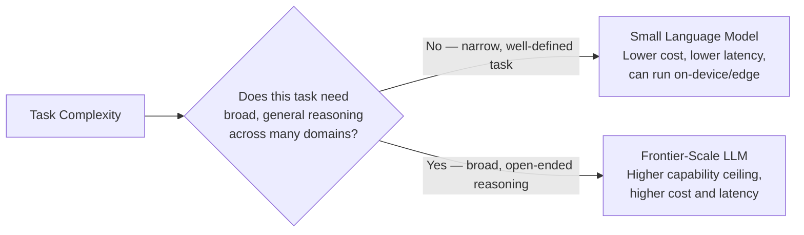

# Small Language Models (SLMs)

> The biggest model isn't the default choice anymore — it's one option on a spectrum, and often not the right one.

**Type:** Learn
**Prerequisites:** Parameter-Efficient Fine-Tuning: LoRA and QLoRA
**Time:** ~25 minutes

## Learning Objectives

- Explain what Small Language Models (SLMs) are and how they differ from frontier-scale LLMs
- Recognize the specific trade-offs: capability, cost, latency, and deployment flexibility
- Judge when an SLM is genuinely sufficient versus when frontier model capability is actually needed
- Ask the right questions when a team defaults to the largest available model without justification

## What It Is

**Small Language Models (SLMs)** are models with substantially fewer parameters than frontier-scale LLMs, often a few hundred million to a few billion parameters versus tens or hundreds of billions. They trade some general capability for major gains in cost, latency, and deployment flexibility.

## Why It Matters

A team builds a simple intent classifier ("is this support message about billing, shipping, or a product defect?") using a frontier-scale LLM at $0.01 per request. A well-tuned SLM, likely combined with the fine-tuning techniques from the previous lesson, could handle this narrow task at a fraction of the cost and latency. The team never evaluated a smaller model; they defaulted to "use the best model available" without matching capability to task complexity.

## How It Works

The core trade-off has three parts.

- **Capability ceiling.** Frontier models handle a wider range of tasks, more nuanced reasoning, and rarer edge cases better, out of the box.
- **Cost and latency.** SLMs are dramatically cheaper per token and faster (both time to first token and generation speed), because they are smaller.
- **Deployment flexibility.** SLMs can often run on-device or on modest local hardware (a 3B-parameter model at 4-bit needs roughly 2 GB of memory), enabling offline use, avoiding network latency, and keeping data on the device.

Narrow, well-defined tasks (classification into a few categories, extracting specific fields, simple format conversion) are often well within an SLM's reach, especially after task-specific fine-tuning. Open-ended reasoning, nuanced judgment, broad world knowledge, or a long tail of edge cases benefit from a frontier model's larger ceiling; using an SLM there risks a real quality gap that the savings do not justify.

## Architecture and Workflow



```archify
src: diagrams/slm-vs-frontier-decision.html
title: Choosing between a small language model and a frontier LLM
aspect: 1340/408
```

## A Real-World Example

Score each task on signals that favor an SLM (narrow and well defined, latency-sensitive, high volume) and signals that favor a frontier model (broad world knowledge, multi-step reasoning, long tail of edge cases).

| Signal | Support ticket classifier | Open-ended research assistant |
| :--- | :--- | :--- |
| Narrow, well-defined | Yes (SLM) | No |
| Latency-sensitive | Yes (SLM) | No |
| High volume, cost-sensitive | Yes (SLM) | No |
| Needs broad world knowledge | No | Yes (frontier) |
| Complex multi-step reasoning | No | Yes (frontier) |
| Long tail of edge cases | No | Yes (frontier) |
| **Verdict** | Strong SLM candidate | Needs a frontier model |

Cost math at scale (illustrative): at 1 million classifications per day, $0.01 per request is $10,000 per day. If a fine-tuned SLM costs about $0.0005 per request, that is $500 per day, a saving of roughly $3.5 million per year. When signals are mixed, benchmark both before deciding.

Production systems increasingly use **tiered architectures**: a cheap, fast SLM handles simple sub-tasks (intent routing, field extraction) and frontier calls are reserved for complex reasoning steps. On-device SLMs serve offline or privacy-sensitive cases.

## What a TPM Needs to Understand

- Defaulting to the largest model for every task is often both more expensive and slower, with no quality benefit for narrow tasks.
- Model size should be a deliberate, task-matched decision evaluated against real task complexity, not a default nobody questioned.
- For high-volume narrow tasks, a small per-request difference compounds into a real business decision.
- The decision is evidence-based: demand a side-by-side evaluation on the team's own data, not vendor benchmarks.
- SLMs shift the deployment picture (on-device, data residency), which affects security and compliance reviews.

## Risks, Dependencies, and Trade-Offs

| Model Size | Cost per Request | Latency | Capability Ceiling | Deployment Flexibility |
| :--- | :--- | :--- | :--- | :--- |
| **Small Language Model (SLM)** | Low | Fast | Lower, sufficient for narrow tasks | High — can run on-device/edge |
| **Frontier-Scale LLM** | Higher | Slower | Higher, better for open-ended/complex tasks | Lower — typically requires substantial infrastructure |

- **Dependencies:** a labeled evaluation set, fine-tuning data and process (LoRA/QLoRA), and a router if using tiers.
- **Failure scenario: silent quality gap.** The SLM is accurate on common cases but fails on rare ones; the saving is erased by escalations and complaints. Mitigation: evaluate on edge cases, measure per-segment accuracy.
- **Failure scenario: router errors.** In a tiered design, a complex request misrouted to the SLM yields a poor answer. Mitigation: confidence thresholds with fallback to the larger model.
- **Operational cost:** self-hosting an SLM means owning updates, monitoring, and hardware.

## Questions to Ask Engineers

1. *"For this specific task, have we evaluated whether a Small Language Model would perform adequately, or did we default to the largest available model without comparison?"*
2. *"If we're using a frontier-scale model for a narrow, well-defined sub-task within a larger pipeline, what's the cost and latency difference versus routing that sub-task to an SLM?"*
3. *"Does this specific task genuinely require broad world knowledge or complex multi-step reasoning, or is it well-defined enough that a smaller, fine-tuned model would suffice?"*

## Scenario Exercise

A customer support platform sends every request (classification, summarization, drafting replies, handling escalations) to one frontier model.

1. **Easy**: Name one SLM-favoring signal for the ticket classification task.
2. **Medium**: Explain in plain English why a task with a long tail of edge cases tends to favor a frontier model over an SLM.
3. **Hard**: Propose a tiered architecture for this platform: which sub-tasks go to an SLM, which stay on a frontier model, how a misrouted request is caught, and what evidence you would require before switching.

## Key Terms

- **Small Language Model (SLM)**: A language model with substantially fewer parameters than frontier-scale LLMs, trading some general capability for lower cost, latency, and greater deployment flexibility.
- **Frontier-Scale LLM**: The largest, most capable class of language models, with the highest capability ceiling but also the highest cost and latency.
- **Task-Model Matching**: The practice of selecting model size based on actual task complexity, rather than defaulting to the largest available model regardless of need.
- **Tiered Model Architecture**: A system design routing different sub-tasks to different model sizes based on their complexity requirements.
