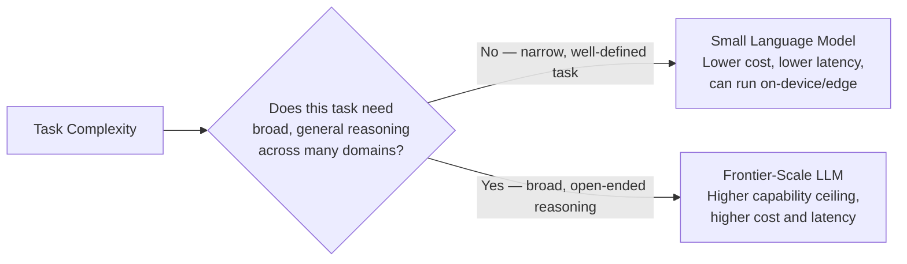

# Small Language Models (SLMs)

> The biggest model isn't the default choice anymore — it's one option on a spectrum, and often not the right one.

**Type:** Learn
**Languages:** Python, Concept
**Prerequisites:** Parameter-Efficient Fine-Tuning: LoRA and QLoRA
**Time:** ~25 minutes

## Learning Objectives

- Understand what Small Language Models (SLMs) are and how they differ from frontier-scale LLMs
- Recognize the specific trade-offs: capability, cost, latency, and deployment flexibility
- Understand when an SLM is genuinely sufficient versus when frontier model capability is actually needed
- Formulate the right questions when a team defaults to the largest available model without justification

## The Problem

A team builds a simple intent classifier (e.g. "is this support message about billing, shipping, or a product defect") using a frontier-scale LLM costing $0.01 per request. A well-tuned Small Language Model, likely combined with the fine-tuning techniques from the previous lesson, could handle this narrow, well-defined task at a fraction of the cost and latency — but the team never evaluated a smaller model, defaulting to "use the best model available" without matching model capability to actual task complexity.

## The Concept

**Small Language Models (SLMs)** are models with substantially fewer parameters than frontier-scale LLMs — often in the range of a few hundred million to a few billion parameters, versus tens or hundreds of billions for the largest frontier models — trading some general capability for major gains in cost, latency, and deployment flexibility.



### The Core Trade-off

- **Capability ceiling**: frontier models generally handle a wider range of tasks, more nuanced reasoning, and less common edge cases better than SLMs, out of the box.
- **Cost and latency**: SLMs are dramatically cheaper per token and faster (both TTFT and generation speed, from the latency optimization lesson) given their smaller size.
- **Deployment flexibility**: SLMs can often run entirely on-device or on modest, local hardware (connecting to the dev environments lesson's discussion of GPU requirements), enabling offline use cases or avoiding network latency and data leaving a device entirely.

### When an SLM Is Genuinely Sufficient

Narrow, well-defined tasks (classification into a small fixed set of categories, extracting specific structured fields, simple format conversion) are often well within an SLM's capability — especially when combined with fine-tuning (previous lesson) for the specific task, or when the task doesn't require broad world knowledge or complex multi-step reasoning.

### When Frontier Capability Is Actually Needed

Open-ended reasoning, nuanced judgment calls, broad world knowledge requirements, or tasks with a very long tail of edge cases genuinely benefit from a frontier-scale model's larger capability ceiling — using an SLM here risks a real, measurable quality gap that a smaller model's cost savings wouldn't be worth.

## Build It

A simplified decision framework scoring whether a task is a good SLM candidate:

```python
def assess_slm_fit(task_name, is_narrow_well_defined, needs_broad_world_knowledge,
                    requires_complex_multistep_reasoning, has_long_tail_edge_cases,
                    latency_sensitive, cost_sensitive_at_scale):
    slm_favoring_signals = []
    frontier_favoring_signals = []

    if is_narrow_well_defined:
        slm_favoring_signals.append("narrow, well-defined task")
    if latency_sensitive:
        slm_favoring_signals.append("latency-sensitive use case")
    if cost_sensitive_at_scale:
        slm_favoring_signals.append("high volume, cost-sensitive at scale")

    if needs_broad_world_knowledge:
        frontier_favoring_signals.append("requires broad world knowledge")
    if requires_complex_multistep_reasoning:
        frontier_favoring_signals.append("requires complex multi-step reasoning")
    if has_long_tail_edge_cases:
        frontier_favoring_signals.append("has a long tail of edge cases")

    print(f"Task: {task_name}")
    print(f"  SLM-favoring signals: {slm_favoring_signals or 'none'}")
    print(f"  Frontier-favoring signals: {frontier_favoring_signals or 'none'}")

    if slm_favoring_signals and not frontier_favoring_signals:
        print("  Recommendation: Strong candidate for a Small Language Model.\n")
    elif frontier_favoring_signals and not slm_favoring_signals:
        print("  Recommendation: Likely needs a frontier-scale model.\n")
    else:
        print("  Recommendation: Mixed signals -- benchmark both before deciding.\n")

assess_slm_fit(
    "Classify support ticket into billing/shipping/defect",
    is_narrow_well_defined=True, needs_broad_world_knowledge=False,
    requires_complex_multistep_reasoning=False, has_long_tail_edge_cases=False,
    latency_sensitive=True, cost_sensitive_at_scale=True,
)

assess_slm_fit(
    "Open-ended research assistant answering arbitrary user questions",
    is_narrow_well_defined=False, needs_broad_world_knowledge=True,
    requires_complex_multistep_reasoning=True, has_long_tail_edge_cases=True,
    latency_sensitive=False, cost_sensitive_at_scale=False,
)
```

The intent classifier scores as a strong SLM candidate across every signal, while the open-ended research assistant scores clearly toward needing frontier capability — giving a defensible, task-specific basis for model size choice instead of a uniform "always use the biggest model" default.

## Use It

Real production systems increasingly use a mix of model sizes matched to task complexity:

- **Tiered model architectures**: routing simple, well-defined sub-tasks to a fast, cheap SLM, and reserving frontier model calls for genuinely complex reasoning steps within the same overall pipeline.
- **On-device SLMs**: enabling offline functionality or avoiding sending sensitive data to an external API, for tasks well within an SLM's capability.
- **Cost-driven model selection at scale**: for extremely high-volume, narrow tasks, even a small per-request cost difference compounds into significant savings, making SLM evaluation a real business decision, not just a technical one.

## Exercises

1. **Easy**: In the code example, name one SLM-favoring signal for the support ticket classification task.
2. **Medium**: Explain in plain English why a task with "a long tail of edge cases" tends to favor a frontier-scale model over an SLM.
3. **Hard**: Propose a tiered architecture for a customer support system: which sub-tasks would you route to an SLM, and which would you reserve for a frontier model, and why?

## TPM Perspective

### Strategic Executive Summary
Defaulting to the largest available model for every task is often both more expensive and slower than necessary, without a corresponding quality benefit for narrow, well-defined tasks. A TPM should expect model size to be a deliberate, task-matched decision — evaluated against actual task complexity — rather than a default setting nobody questioned.

### Questions to Challenge Engineering
1. *"For this specific task, have we evaluated whether a Small Language Model would perform adequately, or did we default to the largest available model without comparison?"*
2. *"If we're using a frontier-scale model for a narrow, well-defined sub-task within a larger pipeline, what's the cost and latency difference versus routing that sub-task to an SLM?"*
3. *"Does this specific task genuinely require broad world knowledge or complex multi-step reasoning, or is it well-defined enough that a smaller, fine-tuned model would suffice?"*

### Trade-Off Matrix

| Model Size | Cost per Request | Latency | Capability Ceiling | Deployment Flexibility |
| :--- | :--- | :--- | :--- | :--- |
| **Small Language Model (SLM)** | Low | Fast | Lower, sufficient for narrow tasks | High — can run on-device/edge |
| **Frontier-Scale LLM** | Higher | Slower | Higher, better for open-ended/complex tasks | Lower — typically requires substantial infrastructure |

## Key Terms

- **Small Language Model (SLM)**: A language model with substantially fewer parameters than frontier-scale LLMs, trading some general capability for lower cost, latency, and greater deployment flexibility.
- **Frontier-Scale LLM**: The largest, most capable class of language models, with the highest capability ceiling but also the highest cost and latency.
- **Task-Model Matching**: The practice of selecting model size based on actual task complexity, rather than defaulting to the largest available model regardless of need.
- **Tiered Model Architecture**: A system design routing different sub-tasks to different model sizes based on their complexity requirements.
