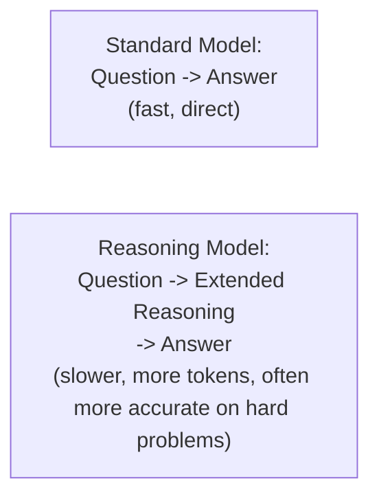

# Reasoning Models

> Thinking longer before answering is itself a capability that had to be trained in — and it changes the cost/latency math you're used to.

**Type:** Learn
**Languages:** Concept
**Prerequisites:** Small Language Models
**Time:** ~30 minutes

## Learning Objectives

- Understand what distinguishes "reasoning models" from standard LLMs: extended, explicit intermediate reasoning before a final answer
- Understand how this connects to and extends chain-of-thought prompting and the ReAct pattern from earlier levels
- Recognize the cost and latency trade-off reasoning models introduce, and when it's worth paying
- Formulate the right questions when deciding whether a task actually benefits from a reasoning model

## The Problem

A team switches their entire product to a reasoning model, assuming "more thinking is always better," and finds both cost and latency increase substantially for tasks that didn't actually need deep reasoning — simple lookups and format conversions took noticeably longer and cost more, without any measurable quality improvement, because those tasks never needed extended reasoning in the first place.

## The Concept

**Reasoning models** are trained to generate extended, explicit intermediate reasoning steps before producing a final answer — conceptually extending the "thought" step from the ReAct pattern (Level 6) into a more deeply trained, systematic capability, rather than something induced only through prompting.



### How This Connects to Earlier Concepts

- **Chain-of-thought prompting** (an extension of the prompting concepts from Level 3) asks a standard model to "think step by step" via prompt instruction — reasoning models have this extended thinking behavior trained in more deeply and reliably, rather than relying entirely on being asked for it.
- **ReAct's "thought" step** (Level 6) is conceptually similar — explicit reasoning before action — but reasoning models often generate substantially more extensive internal reasoning, particularly for complex problems like multi-step math or logic puzzles.

### The Real Trade-off: More Tokens, More Cost, More Latency

Extended reasoning means generating many more tokens before the final answer — directly increasing cost (Level 4's token economics: more output tokens) and latency (Level 8: more generation time). This is a real, calculable cost that must be weighed against the accuracy improvement reasoning provides for a specific task.

### When Reasoning Models Are Worth the Cost

- **Complex, multi-step problems**: math, logic, multi-constraint planning — tasks where a standard model's direct answer is genuinely more error-prone, and the extended reasoning meaningfully improves correctness.
- **High-stakes decisions where accuracy matters more than speed/cost**: a task where getting it right is worth paying more and waiting longer.

### When They're Not Worth It

- **Simple lookups, format conversions, straightforward classification**: tasks a standard model already handles reliably, where extended reasoning adds cost and latency without a measurable accuracy benefit.

## Build It

A simplified cost/benefit framework for deciding whether a task justifies a reasoning model's overhead:

```python
def assess_reasoning_model_fit(task_name, is_multistep_complex, standard_model_error_rate, cost_per_request_standard, cost_per_request_reasoning):
    print(f"Task: {task_name}")
    print(f"  Multi-step/complex: {is_multistep_complex}")
    print(f"  Standard model error rate: {standard_model_error_rate:.0%}")
    print(f"  Cost: standard=${cost_per_request_standard:.4f}, reasoning=${cost_per_request_reasoning:.4f}")

    cost_multiplier = cost_per_request_reasoning / cost_per_request_standard

    if is_multistep_complex and standard_model_error_rate > 0.15:
        print(f"  Recommendation: Reasoning model likely justified -- "
              f"{cost_multiplier:.1f}x cost is worth it given the standard model's high error rate.\n")
    elif not is_multistep_complex and standard_model_error_rate < 0.05:
        print(f"  Recommendation: Standard model is sufficient -- "
              f"paying {cost_multiplier:.1f}x more for reasoning isn't justified by the accuracy gain.\n")
    else:
        print(f"  Recommendation: Benchmark both on your actual golden dataset before deciding.\n")

assess_reasoning_model_fit(
    "Multi-step pricing calculation with several conditional discounts",
    is_multistep_complex=True, standard_model_error_rate=0.22,
    cost_per_request_standard=0.01, cost_per_request_reasoning=0.06,
)

assess_reasoning_model_fit(
    "Extract a customer's name and order number from a short message",
    is_multistep_complex=False, standard_model_error_rate=0.02,
    cost_per_request_standard=0.002, cost_per_request_reasoning=0.015,
)
```

The pricing calculation task justifies the reasoning model's roughly 6x cost premium given the standard model's meaningfully high error rate, while the simple extraction task clearly doesn't — a concrete, task-specific basis for this decision rather than a blanket policy either way.

## Use It

Real production systems apply reasoning models selectively, matched to task complexity:

- **Routing complex sub-tasks to a reasoning model** within a larger pipeline (connecting to the tiered model architecture idea from the previous lesson), while simpler steps use a standard or small model.
- **Using golden dataset evals** (Level 8) to empirically measure whether a reasoning model's accuracy improvement on a specific task justifies its cost and latency premium, rather than assuming it always does.
- **Reserving reasoning models for genuinely hard problems**: math-heavy calculations, complex multi-constraint logic, and similar tasks where standard models demonstrably struggle.

## Exercises

1. **Easy**: In the code example, why does the simple extraction task not justify using a reasoning model?
2. **Medium**: Explain in plain English why "more thinking is always better" is a flawed assumption, connecting to both cost and latency concepts from earlier levels.
3. **Hard**: Propose a specific eval methodology (referencing Level 8's evals lesson) to empirically determine whether a reasoning model is worth its cost premium for a given task in your own product.

## TPM Perspective

### Strategic Executive Summary
Reasoning models are a genuine capability advance for complex, multi-step problems, but they come with a real, calculable cost and latency premium that isn't justified for every task. The decision to use a reasoning model should be based on measured accuracy improvement for the specific task at hand (via evals), not a blanket assumption that more extended reasoning is always better regardless of the problem's actual complexity.

### Questions to Challenge Engineering
1. *"For this specific task, have we measured whether a reasoning model's accuracy improvement over a standard model justifies its cost and latency premium, using our golden dataset?"*
2. *"Is this task genuinely complex/multi-step, or is it a simple lookup/classification task that a standard model already handles reliably?"*
3. *"If we're using a reasoning model across our whole pipeline, could we instead route only the genuinely complex sub-tasks to it, using a standard or small model for the rest?"*

### Trade-Off Matrix

| Task Type | Standard Model Accuracy | Reasoning Model Worth It? |
| :--- | :--- | :--- |
| **Simple lookup/classification** | High | No — added cost/latency without meaningful benefit |
| **Multi-step math/logic** | Often lower | Yes, if measured accuracy improvement justifies the cost |
| **High-stakes decisions** | Varies | Often yes — accuracy may be worth the premium regardless of cost |

## Key Terms

- **Reasoning Model**: A model trained to generate extended, explicit intermediate reasoning steps before producing a final answer.
- **Chain-of-Thought Prompting**: A prompting technique asking a standard model to reason step by step, conceptually related to but distinct from a dedicated reasoning model's trained-in behavior.
- **Reasoning Overhead**: The additional tokens, cost, and latency incurred by a reasoning model's extended intermediate reasoning process.
- **Task-Complexity Matching**: Selecting whether to use a reasoning model based on measured task complexity and accuracy benefit, rather than applying it universally.
