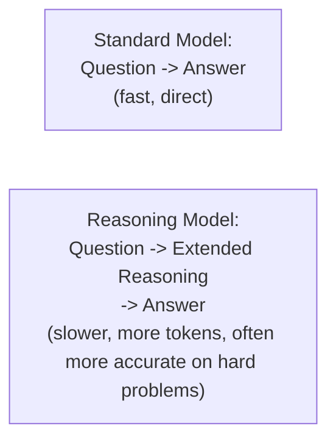

# Reasoning Models

> Thinking longer before answering is itself a capability that had to be trained in — and it changes the cost/latency math you're used to.

**Type:** Learn
**Prerequisites:** Small Language Models
**Time:** ~25 minutes

## Learning Objectives

- Explain what distinguishes "reasoning models" from standard LLMs: extended, explicit intermediate reasoning before a final answer
- Describe how this connects to and extends chain-of-thought prompting and the ReAct pattern from earlier levels
- Recognize the cost and latency trade-off reasoning models introduce, and when it's worth paying
- Ask the right questions when deciding whether a task actually benefits from a reasoning model

## What It Is

**Reasoning models** are trained to generate extended, explicit intermediate reasoning steps before producing a final answer. This extends the "thought" step of the ReAct pattern (Level 6) into a more deeply trained, systematic capability, rather than something induced only through prompting.

- **Chain-of-thought prompting** (Level 3) asks a standard model to "think step by step" through the prompt. Reasoning models have that behavior trained in more deeply and reliably.
- **ReAct's thought step** (Level 6) is conceptually similar, but reasoning models often produce far more extensive reasoning, particularly for multi-step math or logic.

## Why It Matters

A team switches its whole product to a reasoning model, assuming "more thinking is always better." Cost and latency rise substantially for tasks that never needed deep reasoning: simple lookups and format conversions take noticeably longer and cost more with no measurable quality gain.

## How It Works

1. The user submits a question.
2. The model generates a long internal chain of reasoning tokens: decomposing the problem, trying approaches, checking its work.
3. It then produces the final answer.
4. The provider usually bills the reasoning tokens as output tokens, even if they are hidden from the user.

Extended reasoning therefore means many more output tokens (higher cost, per Level 4's token economics) and more generation time (higher latency, per Level 8). Many providers expose a setting for how much reasoning effort to spend, giving a dial between speed and accuracy.

**Worth the cost:** complex multi-step problems (math, logic, multi-constraint planning) where a direct answer is error-prone, and high-stakes decisions where accuracy matters more than speed or cost.

**Not worth the cost:** simple lookups, format conversions, and straightforward classification that a standard model already handles reliably.

## Architecture and Workflow



```archify
src: diagrams/standard-vs-reasoning-model.html
title: Standard model versus reasoning model
aspect: 640/288
```

## A Real-World Example

The deciding number is total cost including the cost of errors, not price per request alone. Assume (illustratively) that each wrong answer costs the business $1 in rework, refunds, or support time.

| Task | Model | Price per request | Error rate | Expected error cost | Total per request |
| :--- | :--- | :--- | :--- | :--- | :--- |
| Multi-step pricing with conditional discounts | Standard | $0.010 | 22% | $0.22 | $0.230 |
| | Reasoning (6x price) | $0.060 | 5% | $0.05 | $0.110 |
| Extract name and order number from a short message | Standard | $0.002 | 2% | $0.02 | $0.022 |
| | Reasoning (7.5x price) | $0.015 | 1% | $0.01 | $0.025 |

The pricing task justifies the 6x premium: the total cost halves because errors drop sharply. The extraction task does not: the reasoning model costs more overall for a one-point accuracy gain. Real systems apply reasoning models selectively, routing only hard sub-tasks to them (the tiered idea from the previous lesson) and using golden dataset evals (Level 8) to measure whether the accuracy gain pays for itself. The accuracy figures above are what the team must measure on its own data.

## What a TPM Needs to Understand

- Reasoning models are a genuine advance for complex, multi-step problems, but the cost and latency premium is real and calculable.
- The decision should rest on measured accuracy improvement for the specific task, not a blanket belief that more reasoning is better.
- Latency matters for user experience: a reasoning model that takes 30 seconds may be unacceptable in a live chat even if its answers are better.
- Reasoning effort is a tunable dial; ask what setting is used and why.
- Hidden reasoning tokens still appear on the bill and in capacity (TPM) planning.

## Risks, Dependencies, and Trade-Offs

| Task Type | Standard Model Accuracy | Reasoning Model Worth It? |
| :--- | :--- | :--- |
| **Simple lookup/classification** | High | No — added cost/latency without meaningful benefit |
| **Multi-step math/logic** | Often lower | Yes, if measured accuracy improvement justifies the cost |
| **High-stakes decisions** | Varies | Often yes — accuracy may be worth the premium regardless of cost |

- **Dependencies:** a golden dataset with realistic hard cases; a provider that exposes reasoning effort controls and usage reporting.
- **Failure scenario: cost blowout.** Reasoning token counts vary per request; a few long chains can dominate the bill. Mitigation: set budgets and alert on token usage.
- **Failure scenario: timeouts.** Long reasoning exceeds client or gateway timeouts. Mitigation: streaming, async patterns, or a lower effort setting.
- **Failure scenario: false confidence.** Reasoned answers still can be wrong and read as more authoritative. Mitigation: evals and guardrails still apply.

## Questions to Ask Engineers

1. *"For this specific task, have we measured whether a reasoning model's accuracy improvement over a standard model justifies its cost and latency premium, using our golden dataset?"*
2. *"Is this task genuinely complex/multi-step, or is it a simple lookup/classification task that a standard model already handles reliably?"*
3. *"If we're using a reasoning model across our whole pipeline, could we instead route only the genuinely complex sub-tasks to it, using a standard or small model for the rest?"*

## Scenario Exercise

Your product team wants to move every feature to a reasoning model after a strong demo.

1. **Easy**: Why does the simple extraction task in the example not justify a reasoning model?
2. **Medium**: Explain in plain English why "more thinking is always better" is flawed, connecting to both cost and latency.
3. **Hard**: Propose an evaluation plan (referencing Level 8) to decide, per feature, whether the reasoning premium is worth it: what data, what metrics (accuracy, cost, latency), and what threshold would make you approve it.

## Key Terms

- **Reasoning Model**: A model trained to generate extended, explicit intermediate reasoning steps before producing a final answer.
- **Chain-of-Thought Prompting**: A prompting technique asking a standard model to reason step by step, conceptually related to but distinct from a dedicated reasoning model's trained-in behavior.
- **Reasoning Overhead**: The additional tokens, cost, and latency incurred by a reasoning model's extended intermediate reasoning process.
- **Task-Complexity Matching**: Selecting whether to use a reasoning model based on measured task complexity and accuracy benefit, rather than applying it universally.
