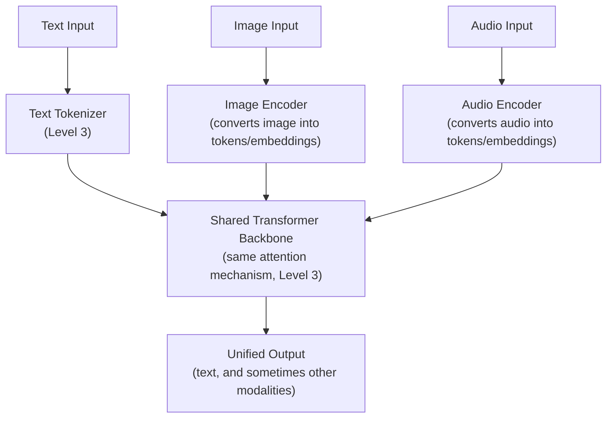

# Multimodal Architectures

> An image isn't fundamentally different from text to the model — it's just tokenized differently before the same attention mechanism takes over.

**Type:** Learn
**Prerequisites:** Reasoning Models
**Time:** ~25 minutes

## Learning Objectives

- Explain what "multimodal" means and how non-text inputs are converted into a form transformers can process
- Describe the general architecture pattern connecting modality-specific encoders to a shared transformer backbone
- Recognize the cost, latency, and evaluation implications of adding image, audio, or video inputs
- Ask the right questions when reviewing a proposed multimodal AI feature's scope and cost

## What It Is

**Multimodal models** process multiple types of input (text, images, audio, sometimes video) within a shared architecture, extending the tokens-and-embeddings foundation from Level 3 to non-text data. Each input type has its own specialized **encoder** that converts it into tokens or embeddings, and a single shared transformer backbone then processes everything together.

## Why It Matters

A team proposes adding image upload to its support chatbot "since the model supports images now." They overlook that image inputs consume dramatically more tokens than an equivalent text description, multiplying cost (Level 4) on every request that includes an image. "The model can do it" was treated as the only relevant question.

## How It Works

1. Each input passes through its own encoder: a text tokenizer, an image encoder, an audio encoder.
2. The encoders output sequences of tokens or embeddings in a shared representation.
3. The same attention mechanism (Level 3) processes all modalities together, which is why the model can reason across an image and a text question about it in one response.
4. The output is usually text, sometimes other modalities.

**Why images cost more.** An image is split into a grid of patches, each turned into one or more tokens. A single moderate-resolution image can consume hundreds to thousands of tokens, often far more than a short text description of the same content. Higher resolution means more patches and more tokens. Audio and video scale with duration in the same way.

**Why evaluation gets harder.** A text-only eval framework cannot score "did the model correctly describe what is in this image." Multimodal evaluation (Level 8) needs golden datasets and scoring methods built for non-text inputs and outputs.

## Architecture and Workflow



```archify
src: diagrams/multimodal-shared-backbone.html
title: Text, image and audio feed one shared backbone
aspect: 1310/408
```

## A Real-World Example

Compare a support request described in text (about 40 input tokens) with a photo of the same issue (about 1,200 input tokens), each producing a 150-token answer. Assumed prices: $0.003 per 1,000 input tokens and $0.015 per 1,000 output tokens.

| | Text description | Photo |
| :--- | :--- | :--- |
| Input tokens | 40 | 1,200 |
| Input cost | $0.00012 | $0.0036 |
| Output cost (150 tokens) | $0.00225 | $0.00225 |
| **Total per request** | **about $0.0024** | **about $0.0059** |

The image request costs about 2.5x more overall, and its input cost is 30x higher; output cost dilutes the total. At 10,000 requests per day, choosing images adds about $35 per day, or roughly $12,700 per year. That is modest here but scales linearly, and larger images, video, or higher volume change the picture quickly. Teams treat a new modality like any scope decision: model the cost before enabling it, build modality-specific evals, and enable it selectively where it improves the experience enough to justify the expense.

## What a TPM Needs to Understand

- "The model supports it now" is a capability statement, not a cost or product justification.
- A new modality brings higher token consumption and needs its own evaluation approach; neither comes free with the model.
- Require the same cost projection and eval planning for a new modality as for any other significant feature.
- Ask about resolution and size limits; they are the main lever on token cost and latency.
- Privacy and security change too: images may contain personal data, and uploaded files are a new input channel for malicious content.

## Risks, Dependencies, and Trade-Offs

| Modality Addition Approach | Cost Awareness | Eval Coverage | User Experience Benefit |
| :--- | :--- | :--- | :--- |
| **Enable broadly because "the model supports it"** | Low — cost not modeled upfront | Low — relies on untested text-only evals | Unclear — not validated against actual need |
| **Scoped rollout with cost projection and dedicated evals** | High — cost modeled before launch | High — modality-specific evaluation | Validated against specific, justified use cases |

- **Dependencies:** an image or audio encoder supplied by the model vendor, storage and handling for uploaded media, and labeled multimodal test data.
- **Failure scenario: cost surprise.** Users upload high-resolution photos at volume; spend rises well past forecast. Mitigation: resize or limit uploads, set budgets.
- **Failure scenario: silent quality problems.** The model misreads blurry or cropped images and no text eval catches it. Mitigation: dedicated multimodal test sets including poor-quality inputs.
- **Failure scenario: injected instructions.** Text hidden inside an image can try to steer the model (a form of prompt injection). Mitigation: treat image content as untrusted.
- **Latency:** larger inputs increase time to first token.

## Questions to Ask Engineers

1. *"Have we projected the token cost difference of adding this modality at our expected usage scale, or are we enabling it simply because the underlying model supports it?"*
2. *"Do we have an evaluation approach specifically designed for this new modality, or are we assuming our existing text-only evals will transfer automatically?"*
3. *"Is this modality being enabled broadly by default, or scoped to the specific use cases where it demonstrably improves the user experience enough to justify its added cost?"*

## Scenario Exercise

Your support chatbot team wants to launch image upload for all 10,000 daily requests.

1. **Easy**: In the example above, roughly how many times more expensive is the image-based request than the text-only one?
2. **Medium**: Explain in plain English why a text-only evaluation framework cannot automatically judge whether a multimodal model described an image correctly.
3. **Hard**: Propose a scoped rollout plan for image upload covering cost projection, eval design, which use cases justify the expense (for example damaged-product claims), and what limits or guardrails you would set.

## Key Terms

- **Multimodal Model**: A model architecture that processes multiple input types (text, image, audio) within a shared framework, typically via modality-specific encoders feeding a shared transformer backbone.
- **Modality-Specific Encoder**: A component that converts a non-text input (image, audio) into tokens or embeddings compatible with the shared transformer architecture.
- **Image Tokenization**: The process of breaking an image into patches converted into tokens, often consuming significantly more tokens than an equivalent text description.
- **Multimodal Evaluation**: Evaluation methods and golden datasets specifically designed for non-text inputs/outputs, distinct from text-only eval frameworks.
