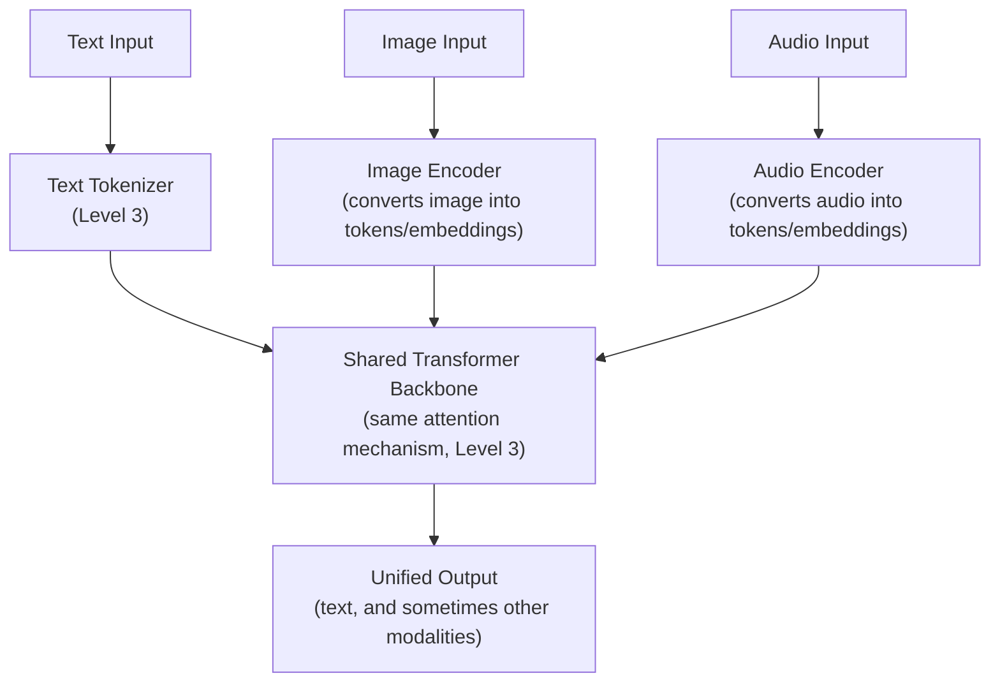

# Multimodal Architectures

> An image isn't fundamentally different from text to the model — it's just tokenized differently before the same attention mechanism takes over.

**Type:** Learn
**Languages:** Concept
**Prerequisites:** Reasoning Models
**Time:** ~30 minutes

## Learning Objectives

- Understand what "multimodal" means and how non-text inputs are converted into a form transformers can process
- Understand the general architecture pattern connecting modality-specific encoders to a shared transformer backbone
- Recognize the specific cost, latency, and evaluation implications of adding image, audio, or video inputs
- Formulate the right questions when reviewing a proposed multimodal AI feature's scope and cost

## The Problem

A team proposes adding image upload support to their support chatbot "since the model supports images now," without considering that image inputs consume dramatically more tokens than an equivalent text description would, directly multiplying costs (Level 4's token economics) for every image-containing request — a detail easy to overlook when "the model can do it" is treated as the only relevant question.

## The Concept

**Multimodal models** process multiple types of input (text, images, audio, sometimes video) within a shared architecture — extending the tokens-and-embeddings foundation from Level 3 to non-text data.



### The General Pattern: Modality-Specific Encoders + Shared Backbone

Each input type (image, audio) has its own specialized encoder that converts it into a sequence of tokens or embeddings compatible with the same underlying transformer architecture (Level 3) that processes text. Once converted into this shared representation, the same attention mechanism processes all modalities together — this is why a multimodal model can "reason across" an image and a text question about it in the same response.

### Why Images (and Other Modalities) Consume More Tokens Than Expected

An image is typically broken into a grid of patches, each converted into one or more tokens — a single moderate-resolution image can consume hundreds to thousands of tokens, often far more than a short text description of the same content would require. This directly connects to token economics (Level 4): adding image support isn't a "free" capability unlock, it's a new, potentially significant cost driver that should be modeled explicitly.

### Evaluation Gets Harder, Not Just the Architecture

Evaluating multimodal outputs (Level 8's evals lesson) requires extending golden datasets and scoring methods to handle non-text inputs and outputs — a text-only eval framework doesn't automatically know how to score "did the model correctly describe what's in this image," requiring dedicated multimodal eval design, not an assumption that existing text evals transfer directly.

## Build It

A simplified cost comparison showing why adding image input isn't cost-neutral compared to an equivalent text description:

```python
def estimate_request_cost(input_tokens, output_tokens, price_per_1k_input=0.003, price_per_1k_output=0.015):
    input_cost = (input_tokens / 1000) * price_per_1k_input
    output_cost = (output_tokens / 1000) * price_per_1k_output
    return input_cost + output_cost

text_description_tokens = 40
image_tokens = 1200

text_only_cost = estimate_request_cost(input_tokens=text_description_tokens, output_tokens=150)
image_based_cost = estimate_request_cost(input_tokens=image_tokens, output_tokens=150)

print(f"Text-only request (text description of an issue): {text_description_tokens} input tokens")
print(f"  Estimated cost: ${text_only_cost:.4f}")

print(f"\nImage-based request (photo of the same issue): {image_tokens} input tokens")
print(f"  Estimated cost: ${image_based_cost:.4f}")

print(f"\nImage-based request costs {image_based_cost / text_only_cost:.1f}x more per request "
      f"than the equivalent text-only version.")

daily_volume = 10_000
print(f"\nAt {daily_volume:,} requests/day, choosing image support over text-only adds "
      f"${(image_based_cost - text_only_cost) * daily_volume:,.2f}/day in additional cost.")
```

This makes the "the model supports images now" decision concrete: at meaningful scale, the additional token cost of image inputs is a real, calculable, and potentially significant budget line item — not a free capability unlock.

## Use It

Real production teams treat multimodal feature additions with the same rigor as any other scope decision:

- **Cost modeling before enabling a new modality**: projecting the token cost difference at expected scale, the same way any other feature's cost is projected (Level 4).
- **Modality-specific eval design**: building or extending golden datasets specifically for image/audio inputs, rather than assuming existing text-only evals transfer automatically.
- **Selective enablement**: offering image upload only where it genuinely improves the user experience enough to justify the added cost, rather than enabling it everywhere by default just because the underlying model supports it.

## Exercises

1. **Easy**: In the code example, roughly how many times more expensive is the image-based request compared to the text-only version?
2. **Medium**: Explain in plain English why a text-only evaluation framework can't automatically evaluate whether a multimodal model correctly described an image.
3. **Hard**: Propose a scoped rollout plan for adding image upload support to a support chatbot, considering cost projection, eval design, and which specific use cases justify the added expense.

## TPM Perspective

### Strategic Executive Summary
"The model supports it now" is a capability statement, not a cost or product justification — adding a new modality (images, audio) to a feature has real, calculable cost implications (often significantly higher token consumption) and requires its own evaluation approach, neither of which should be assumed to come for free alongside the underlying model capability. A TPM should require the same cost projection and eval planning rigor for a new modality that any other significant feature addition would require.

### Questions to Challenge Engineering
1. *"Have we projected the token cost difference of adding this modality at our expected usage scale, or are we enabling it simply because the underlying model supports it?"*
2. *"Do we have an evaluation approach specifically designed for this new modality, or are we assuming our existing text-only evals will transfer automatically?"*
3. *"Is this modality being enabled broadly by default, or scoped to the specific use cases where it demonstrably improves the user experience enough to justify its added cost?"*

### Trade-Off Matrix

| Modality Addition Approach | Cost Awareness | Eval Coverage | User Experience Benefit |
| :--- | :--- | :--- | :--- |
| **Enable broadly because "the model supports it"** | Low — cost not modeled upfront | Low — relies on untested text-only evals | Unclear — not validated against actual need |
| **Scoped rollout with cost projection and dedicated evals** | High — cost modeled before launch | High — modality-specific evaluation | Validated against specific, justified use cases |

## Key Terms

- **Multimodal Model**: A model architecture that processes multiple input types (text, image, audio) within a shared framework, typically via modality-specific encoders feeding a shared transformer backbone.
- **Modality-Specific Encoder**: A component that converts a non-text input (image, audio) into tokens or embeddings compatible with the shared transformer architecture.
- **Image Tokenization**: The process of breaking an image into patches converted into tokens, often consuming significantly more tokens than an equivalent text description.
- **Multimodal Evaluation**: Evaluation methods and golden datasets specifically designed for non-text inputs/outputs, distinct from text-only eval frameworks.
